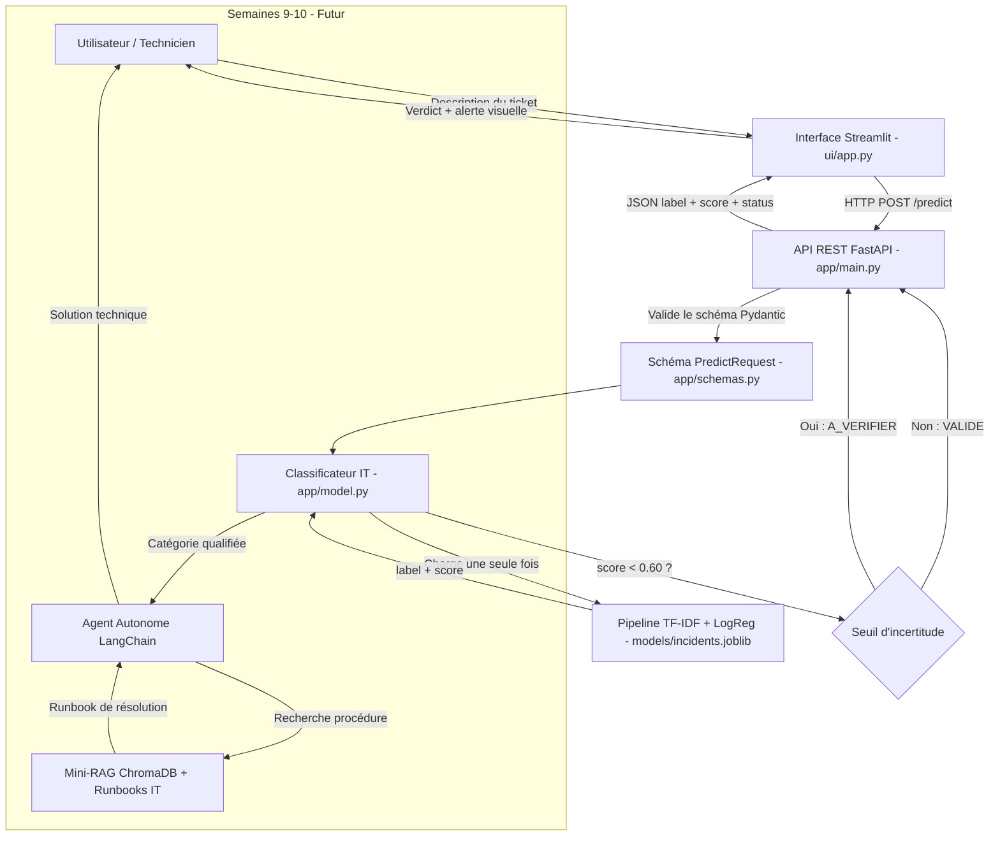

# Fiche de cadrage du projet

**Cours** : Développement et déploiement d'applications intelligentes
**Projet d'agent IA en binôme**

---

## 1. Identification du binôme

|  | Membre A | Membre B |
|---|---|---|
| Nom | Lamzouri | Amrani |
| Prénom | Ishak | Ismail |
| Identifiant GitHub | [@inazuma2004](https://github.com/inazuma2004) | [@Amaranix](https://github.com/Amaranix) |
| Adresse courriel | lamzouriishak@gmail.com | amranix33@gmail.com |
| Groupe / Section | G3 — IAD (IA & Data) | G3 — IAD (IA & Data) |

**Dépôt GitHub officiel :** https://github.com/inazuma2004/Lamzouri_Ishak-Amrani_Ismail_Projet20  
**Dépôt GitHub TPs (référence) :** https://github.com/Amaranix/AI-DEV-DEP-Amrani_Ismail

---

## 2. Projet choisi

- **Numéro du projet** : 01
- **Intitulé du projet** : Agent Autonome de Résolution d'Incidents IT (IT Helpdesk Intelligent)
- **Type** : ☑ Informatique (1 à 20)  ☐ Industriel (21 à 40)
- **Catégorie** : Génie logiciel / Support informatique / NLP

---

## 3. Descriptif proposé

**Problème à résoudre**

Dans les centres d'assistance informatique (IT Service Desk) des organisations, des centaines à des milliers de tickets arrivent chaque jour rédigés en langage naturel par des utilisateurs non-techniciens. Le traitement est aujourd'hui entièrement manuel : un technicien de niveau 1 lit chaque ticket, identifie la catégorie (matériel, accès, stockage, ressources humaines, achat, etc.) et le réoriente vers l'équipe compétente. Ce processus est lent, coûteux en main-d'œuvre et sujet à des erreurs d'aiguillage qui multiplient les allers-retours entre équipes et rallongent les délais de résolution.

**Utilisateurs cibles**

Les utilisateurs finaux sont les techniciens de support IT de niveau 1, les responsables de service desk, et indirectement les employés qui soumettent leurs incidents. L'agent leur permet de recevoir instantanément la catégorie de leur ticket et le statut de confiance du modèle, sans intervention humaine pour les cas clairs.

**Fonctionnalités principales de l'agent**

1. **Classification automatique** : L'agent analyse la description textuelle d'un incident et prédit sa catégorie parmi 8 classes (Hardware, HR Support, Access, Miscellaneous, Storage, Purchase, Internal Project, Administrative rights) avec un score de confiance.
2. **Gestion de l'incertitude** : Si la confiance est inférieure à 60 %, l'agent renvoie le statut `A_VERIFIER` et alerte l'opérateur humain plutôt que de forcer une mauvaise décision automatique.
3. **Interface utilisateur web** : Une interface Streamlit permet la saisie d'un ticket unitaire ou le traitement par lot d'un fichier CSV, avec affichage du verdict et téléchargement des résultats.
4. **API REST** : Un service FastAPI expose les endpoints `/predict` et `/health` pour une intégration dans des systèmes tiers (portails ITSM, Slack bots, etc.).

**Périmètre retenu pour le cours**

| Inclus dans le projet | Exclu du projet (hors périmètre) |
|---|---|
| Pipeline ML supervisé (TF-IDF + Régression Logistique) | Modèle de langage génératif (LLM, GPT-4, Claude) |
| API REST FastAPI avec validation Pydantic | Intégration avec des plateformes ITSM externes (ServiceNow, Jira) |
| Interface Streamlit (saisie unitaire + lot CSV) | Notifications push ou e-mail automatiques |
| Mécanisme d'abstention (seuil de confiance 60 %) | Apprentissage en ligne (online learning) en production |
| Mini-RAG local avec runbooks IT (Semaines 9-10) | Déploiement cloud public payant (AWS, Azure) |
| CI/CD GitHub Actions (ruff, mypy, pytest) | Application mobile |

---

## 4. Dataset

| Élément | Réponse |
|---|---|
| Nom du fichier CSV joint ou lien | `all_tickets_processed_improved_v3.csv` — [Kaggle IT Service Ticket Classification Dataset](https://www.kaggle.com/datasets/adisongoh/it-service-ticket-classification-dataset) |
| Source (site, organisme, génération propre) | Kaggle — Adison Goh (données réelles d'un service desk d'entreprise anonymisées) |
| Taille approximative (lignes, colonnes, Mo) | 47 837 lignes, 2 colonnes, ~14.5 Mo |
| Licence ou conditions d'utilisation | CC0 : Domaine Public — utilisation libre, sans restriction |
| Format des données (CSV, JSON, PDF, logs, images) | CSV (UTF-8, séparateur virgule) |

**Description des colonnes ou champs principaux**

| Colonne / Champ | Type | Description | Exemple de valeur |
|---|---|---|---|
| `Document` | text (str) | Description textuelle libre de l'incident saisie par l'utilisateur en anglais | `"cannot login vpn password expired"` |
| `Topic_group` | catégorie (str) | Catégorie cible annotée par les techniciens de support — 8 valeurs possibles | `"Access"` |

**Distribution des catégories :**

| Catégorie | Occurrences approx. | % |
|---|---|---|
| Hardware | 13 617 | 28 % |
| HR Support | 10 915 | 23 % |
| Access | 7 125 | 15 % |
| Miscellaneous | 7 060 | 15 % |
| Storage | 2 777 | 6 % |
| Purchase | 2 464 | 5 % |
| Internal Project | 2 119 | 4 % |
| Administrative rights | 1 760 | 4 % |

**Si les données sont générées ou simulées :**

Les données sont 100 % réelles — tickets authentiques d'un service desk d'entreprise, anonymisés et publiés sous licence CC0. Aucune génération synthétique n'est utilisée pour l'entraînement principal.

---

## 5. Proposition de maquette

### 5.1 Interface et flux d'interaction

**Type d'interface** : ☑ Application web  ☐ Interface en ligne de commande  ☑ API  ☐ Chatbot  ☐ Tableau de bord  ☐ Autre

**Écrans ou étapes principales**

| Écran / Étape | Ce que l'utilisateur fait (entrée) | Ce que l'agent renvoie (sortie) |
|---|---|---|
| 1. Saisie d'un ticket | L'utilisateur tape la description de son incident dans une zone de texte | Catégorie prédite + score de confiance (%) + statut `VALIDE` ou `À VÉRIFIER` |
| 2. Alerte d'incertitude | Le modèle hésite (score < 60 %) | Avertissement orange : *« À vérifier par un technicien humain »* |
| 3. Traitement par lot | L'utilisateur importe un fichier CSV de tickets | Tableau annoté avec catégorie + score par ligne + bouton de téléchargement |

**Lien ou fichier de la maquette** : Captures d'écran disponibles dans `docs/captures/interface_streamlit.png` et `docs/captures/interface_csv.png`.

### 5.2 Schéma d'architecture de l'agent



**Explication du schéma**

L'utilisateur soumet un ticket via l'interface Streamlit. Cette interface ne connaît pas le modèle ML : elle délègue entièrement à l'API REST FastAPI via HTTP. L'API valide le format de la requête avec Pydantic (protection 422), charge le modèle `incidents.joblib` une seule fois au démarrage (pattern `lifespan`), prédit la catégorie et calcule le statut selon le seuil d'incertitude (60 %). En Semaines 9-10, la catégorie qualifiée sera transmise à un agent LangChain qui interrogera une base vectorielle ChromaDB indexant les runbooks de dépannage IT pour fournir la procédure de résolution directement à l'utilisateur.

---

## 6. Technologies et outils

### 6.1 Développement

| Catégorie | Outil ou technologie choisi | Justification du choix |
|---|---|---|
| Langage de programmation | Python 3.13 | Ecosystème ML/NLP le plus riche, compatible avec toute la stack du cours (scikit-learn, FastAPI, Streamlit) |
| Framework d'agents (LangChain, LlamaIndex, CrewAI, AutoGen, etc.) | LangChain (Semaines 9-10) | Standard industriel pour l'orchestration d'agents avec outils, mémoire et RAG ; documentation riche et exemples IT support disponibles |
| Modèle LLM (fournisseur et modèle) | Pipeline scikit-learn (TF-IDF + LogReg) pour S2-S5 ; LLM local Ollama (llama3) pour S9-S10 | Conforme contrainte du cours : aucun GPU, aucune API payante. Ollama permet de faire tourner un LLM sur CPU laptop |
| Base vectorielle (si RAG) | ChromaDB (local, persistant) | Léger, sans serveur séparé, s'intègre nativement avec LangChain et sentence-transformers |
| Bibliothèques principales | scikit-learn, pandas, FastAPI, Pydantic v2, Streamlit, httpx, joblib, sentence-transformers | Stack minimale exigée par le cours, sans dépendance cloud ni GPU |
| Outils de test | pytest, pytest-cov, hypothesis | Conformes aux exigences S4 : tests unitaires, aux limites, de propriété, couverture > 95 % |
| Gestion de version (Git, plateforme) | Git + GitHub (`inazuma2004/Lamzouri_Ishak-Amrani_Ismail_Projet20`) | Dépôt unique pour tout le projet, workflow PR obligatoire sur `main` |

### 6.2 Déploiement

| Catégorie | Outil ou technologie choisi | Justification du choix |
|---|---|---|
| Conteneurisation (Docker, etc.) | Docker + Docker Compose (S6-S8) | Garantit la reproductibilité sur toute machine sans intervention manuelle sur l'environnement |
| Hébergement (cloud, serveur, local) | Local (PC étudiant) / Render.com (gratuit) | Contrainte du cours : pas de plateforme payante ; Render offre un tier gratuit pour FastAPI |
| CI/CD | GitHub Actions | Exécuté à chaque push : `ruff check`, `mypy`, `pytest --cov-fail-under=95`, validation de `metrics.json` |
| Monitoring et journalisation | Logs structurés via `logging` Python + `docs/journal_temps_reel.md` | Traçabilité académique imposée par le cours ; pas de solution cloud requise |
| Gestion des secrets et clés API | Variables d'environnement `.env` + `python-dotenv` (exclu du Git) | Aucun secret ne doit apparaître dans le dépôt — `.env` dans `.gitignore` |
| Exposition de l'application (API, interface web) | FastAPI (`uvicorn`) sur port 8000 + Streamlit sur port 8501 | Deux processus distincts, couplage uniquement via HTTP — architecture découplée exigée par le cours |

---

## 7. Répartition des tâches et calendrier

| Étape | Responsable | Date de début | Date de fin | Livrable |
|---|---|---|---|---|
| Cadrage et choix des données | Les deux | 12/10/2026 | 19/10/2026 | Cette fiche + vidéos de cadrage |
| Préparation du dataset | Ishak Lamzouri | 19/10/2026 | 22/10/2026 | `data/all_tickets_processed_improved_v3.csv` intégré |
| Développement pipeline ML (S2) | Ishak Lamzouri | 19/10/2026 | 22/10/2026 | `src/train.py`, `src/predict.py`, `models/metrics.json` (F1 = 0.857) |
| API REST FastAPI (S3) | Ishak Lamzouri | 22/10/2026 | 24/10/2026 | `app/main.py`, `app/schemas.py`, `app/model.py` |
| Tests, qualité, jeu d'or (S4) | Ismail Amrani | 22/10/2026 | 25/10/2026 | `tests/` (20 passed, 4 xfailed), ruff ✅, mypy ✅ |
| Interface Streamlit (S5) | Ismail Amrani | 24/10/2026 | 26/10/2026 | `ui/app.py`, `ui/client.py` |
| Conteneurisation Docker (S6-S8) | Les deux | 27/10/2026 | 10/11/2026 | `Dockerfile`, `docker-compose.yml`, CI verte |
| Mini-RAG + Agent LangChain (S9-S10) | Les deux | 10/11/2026 | 24/11/2026 | Runbooks indexés, agent autonome fonctionnel |
| Documentation et présentation (S11) | Les deux | 24/11/2026 | 01/12/2026 | `docs/compte-rendu.md`, soutenance |

---

## 8. Questionnaire de cadrage

### Compréhension du besoin

**Q1. Quel problème concret votre agent résout-il, et comment ce problème est-il traité aujourd'hui sans agent IA ?**

Notre agent résout le problème du **triage et du routage manuel des tickets IT**. Aujourd'hui, sans agent IA, un technicien de support de niveau 1 lit chaque ticket arrivant dans la file d'attente, identifie mentalement la nature du problème (est-ce un problème matériel ? un problème d'accès ? une demande d'achat ?) et le réoriente manuellement vers l'équipe spécialisée compétente. Ce processus présente trois défauts majeurs : il est lent (délai de traitement de plusieurs heures pour les tickets en heures creuses), coûteux en ressources humaines (jusqu'à 30 % du temps d'un technicien N1 est consacré à cette seule tâche de tri selon les études ITSM), et source d'erreurs d'aiguillage récurrentes dues à l'ambiguïté des formulations en langage naturel. Notre agent automatise ce triage en moins de 5 millisecondes, libérant les techniciens pour des tâches à plus haute valeur ajoutée.

**Q2. Qui est l'utilisateur final de votre agent, et comment interagit-il avec lui au quotidien ?**

Les utilisateurs finaux sont principalement les **techniciens IT de niveau 1** des centres de service (Service Desk) dans des moyennes et grandes organisations. Ils interagissent avec l'agent via une interface Streamlit accessible depuis leur navigateur. Au quotidien, un technicien colle la description d'un ticket dans la zone de saisie et obtient immédiatement la catégorie prédite et le score de confiance. Pour les traitements en volume (fin de journée, rattrapage de backlog), il peut importer un fichier CSV contenant plusieurs dizaines ou centaines de tickets et télécharger le fichier résultat annoté. Un utilisateur secondaire est l'**employé non-technicien** qui soumet lui-même son incident et reçoit instantanément une confirmation de routing avec un délai de traitement estimé selon la catégorie. Les développeurs et intégrateurs utilisent quant à eux directement l'API REST.

**Q3. Quelle valeur ajoutée apporte l'agent par rapport à une solution classique (script, règles fixes, recherche manuelle) ?**

Par rapport à un script à base de règles (regex, mots-clés), notre agent apporte trois avantages fondamentaux. Premièrement, la **généralisation linguistique** : le modèle TF-IDF + régression logistique entraîné sur 47 837 tickets réels apprend les patterns statistiques du vocabulaire métier IT et peut traiter des formulations jamais vues lors de l'entraînement. Un script à règles rigides échoue dès qu'un utilisateur formule sa panne différemment. Deuxièmement, la **quantification de l'incertitude** : notre agent sait qu'il ne sait pas. Grâce au mécanisme d'abstention (seuil à 60 %), il renvoie un signal explicite `A_VERIFIER` pour les cas ambigus, là où un script retournerait soit une mauvaise réponse, soit une absence de réponse. Troisièmement, l'**extensibilité agentique** : la brique ML classique sera complétée aux Semaines 9-10 par un mini-RAG indexant les runbooks de résolution, permettant à l'agent de non seulement router le ticket, mais d'y apporter une première solution technique contextualisée.

### Raisonnement et comportement de l'agent

**Q4. Quelles sont les entrées de l'agent et quelles sorties produit-il ? Donnez un exemple complet d'interaction.**

**Entrée** : Une description textuelle libre en anglais (entre 1 et 2 000 caractères) saisie par un utilisateur ou envoyée via API JSON.

**Sortie** : Un objet JSON structuré contenant :
- `label` (str) : la catégorie prédite parmi les 8 classes du dataset.
- `score` (float) : la probabilité de la classe prédite (entre 0 et 1).
- `status` (str) : `"VALIDE"` si score ≥ 0.60, sinon `"A_VERIFIER"`.
- `text` (str) : aperçu des 100 premiers caractères de l'entrée.

**Exemple complet d'interaction :**
```
Entrée : "I cannot log into my VPN account, password seems expired after security update"

Sortie :
{
  "label": "Access",
  "score": 0.9234,
  "status": "VALIDE",
  "text": "I cannot log into my VPN account, password seems expired after security updat"
}

Interface : 🟢 Catégorie : Access | Confiance : 92.3% | Statut : VALIDE
```

**Q5. Quelles décisions l'agent prend-il de façon autonome, et quels outils externes appelle-t-il pour y parvenir ?**

Dans la version actuelle (S2-S5), l'agent prend deux décisions autonomes : la **classification de la catégorie** (sur la base des coefficients TF-IDF appris) et la **décision d'abstention** (comparaison du score à un seuil calibré). Il n'appelle aucun outil externe : tout est local. Dans la version finale (S9-S10), l'agent LangChain prendra trois décisions supplémentaires : (1) déclencher ou non une recherche dans la base vectorielle selon la catégorie qualifiée, (2) sélectionner le runbook le plus pertinent parmi ceux indexés dans ChromaDB, et (3) synthétiser une réponse technique via le LLM local Ollama. Les outils externes appelés seront : `chromadb.query()` pour la recherche vectorielle, `sentence_transformers.encode()` pour l'embedding de la requête, et `ollama.chat()` pour la génération de la réponse finale.

**Q6. Quel type de mémoire votre agent utilise-t-il et pourquoi ?**

Dans sa version actuelle (S2-S5), l'agent n'utilise **aucune mémoire conversationnelle** : chaque ticket est traité de manière stateless et indépendante, ce qui est conforme au cas d'usage (chaque ticket est une requête autonome, sans lien avec les précédentes). Le modèle scikit-learn est chargé une seule fois en mémoire vive au démarrage du serveur (pattern `lifespan` de FastAPI) et réutilisé pour toutes les requêtes suivantes — c'est une forme de mémoire de travail partagée entre requêtes. Dans la version agentique (S9-S10), l'agent utilisera une **mémoire à long terme de type base vectorielle** (ChromaDB persistant sur disque) pour indexer les runbooks de dépannage IT. Cette mémoire est sémantique : elle permet de retrouver la procédure la plus proche d'une requête même si les mots-clés exacts ne correspondent pas, grâce aux embeddings `all-MiniLM-L6-v2`.

### Données

**Q7. Décrivez la qualité de vos données : valeurs manquantes, bruit, déséquilibre, biais potentiels. Quelles étapes de préparation sont prévues ?**

Le dataset présente plusieurs caractéristiques qualitatives à considérer. **Valeurs manquantes** : le CSV contient peu de valeurs nulles (< 0.1 %) — elles sont supprimées lors du nettoyage initial dans `_valider_df()`. **Bruit lexical** : les tickets sont en anglais mais avec un niveau de langue très variable — certains sont tronqués, contiennent des erreurs typographiques ou des abréviations non standardisées. Le pipeline TF-IDF gère naturellement ce bruit via la fréquence statistique (les termes rares ou erronés obtiennent de faibles poids). **Déséquilibre de classes** : Hardware (28 %) et HR Support (23 %) dominent largement, tandis que Administrative rights (4 %) et Internal Project (4 %) sont sous-représentés. Ce déséquilibre est compensé par le paramètre `class_weight="balanced"` de la `LogisticRegression`. **Biais potentiels** : le dataset provient d'une seule organisation anglophone, ce qui peut introduire un biais de jargon interne peu transposable à d'autres organisations. **Étapes de préparation** : nettoyage des valeurs nulles, découpage 80/20 stratifié avant vectorisation (pour éviter le data leakage), et vectorisation TF-IDF (1 à 2-grammes, `sublinear_tf=True`, `min_df=2`).

**Q8. Quelles sont les limites de votre dataset, et comment ces limites influencent-elles les résultats attendus ?**

Trois limites principales : (1) **Origine unique** — tous les tickets proviennent d'une seule organisation, ce qui signifie que le modèle peut être peu robuste sur des tickets d'entreprises avec un jargon différent. En production réelle, un fine-tuning sur les données de l'organisation cible serait nécessaire. (2) **Langue unique** — le dataset est exclusivement en anglais. Une organisation francophone ou multilingue nécessiterait un dataset différent ou une étape de traduction. (3) **Labels fixes** — les 8 catégories sont figées dans le temps. Si l'organisation crée une nouvelle catégorie de tickets (ex : `Cybersecurity Incident`), il faudra ré-entraîner le modèle. Ces limites justifient le seuil d'abstention (60 %) et la stratégie `A_VERIFIER` : lorsque le modèle rencontre un ticket hors de sa distribution d'entraînement, il signale son incertitude plutôt que de forcer une mauvaise décision.

### Architecture et choix techniques

**Q9. Justifiez le choix de votre framework d'agents et de votre modèle LLM. Quelles alternatives avez-vous écartées et pourquoi ?**

Pour la classification initiale (S2-S5), nous avons retenu le pipeline `scikit-learn` (TF-IDF + LogisticRegression) et écarté les alternatives suivantes : (a) **Transformers HuggingFace (BERT, CamemBERT)** — performances supérieures mais nécessitent un GPU en inférence, violant la contrainte du cours (ordinateur portable standard). (b) **LLM API OpenAI** — coût variable par requête et dépendance à une API externe payante, incompatible avec la contrainte de gratuité totale. Pour l'orchestration agentique (S9-S10), nous avons retenu **LangChain** et écarté : (a) **LlamaIndex** — centré sur le RAG documentaire mais moins adapté à l'orchestration multi-étapes avec outils. (b) **CrewAI** — adapté aux agents multi-rôles mais sur-dimensionné pour un agent mono-tâche de service desk. Pour le LLM local, nous avons retenu **Ollama (llama3)** car il s'exécute entièrement sur CPU sans GPU requis, est totalement gratuit, et s'intègre nativement avec LangChain via `langchain-ollama`.

**Q10. Comment votre architecture gère-t-elle les erreurs ?**

Notre architecture gère les erreurs à trois niveaux : (1) **Entrées invalides** — Pydantic v2 rejette automatiquement les textes vides (après `str.strip()`), trop longs (> 2 000 caractères) ou de type incorrect avec un code HTTP 422 structuré contenant une liste d'erreurs détaillée. (2) **Pannes du modèle** — si le modèle lève une exception interne inattendue, l'API capture l'exception via un bloc `try/except` global et retourne un code HTTP 500 (pas 422) pour indiquer clairement que c'est une défaillance serveur et non une erreur cliente. Si le fichier `.joblib` est absent au démarrage, l'API refuse de se lancer (`FileNotFoundError` + `Application startup failed`). (3) **Indisponibilité de l'API** — l'interface Streamlit capture les exceptions `httpx.TransportError` et affiche un message lisible « API injoignable : lancez d'abord uvicorn app.main:app » sans crash.

### Déploiement

**Q11. Décrivez l'environnement de déploiement cible. Comment un utilisateur accède-t-il à l'agent une fois déployé ?**

L'environnement de déploiement cible est une machine standard sans GPU (ordinateur portable ou serveur d'organisation low-cost). Le déploiement suit trois étapes progressives : (1) **Local (S2-S5)** : deux processus distincts sur le même poste — `uvicorn app.main:app --reload` (port 8000) et `streamlit run ui/app.py` (port 8501). L'utilisateur accède via `http://localhost:8501`. (2) **Conteneurisé (S6-S8)** : `docker-compose up` lance les deux services en parallèle. (3) **Déployé (S9-S11)** : l'API FastAPI est déployée sur Render.com (tier gratuit) et l'interface Streamlit sur Streamlit Cloud (gratuit). L'utilisateur final accède à une URL publique depuis n'importe quel navigateur sans installation.

**Q12. Quels sont les coûts d'exploitation attendus et comment les maîtriser ?**

Les coûts d'exploitation sont nuls pour la version ML classique (S2-S5) : le pipeline scikit-learn tourne entièrement sur CPU local sans appel à des API payantes. Pour la version agentique (S9-S10), l'utilisation d'Ollama avec llama3 en local garantit également un coût nul en inférence LLM. Le seul coût potentiel est l'hébergement cloud en cas de déploiement public : Render.com (tier gratuit : 512 Mo RAM, mise en veille après 15 min d'inactivité) et Streamlit Cloud (gratuit pour les dépôts publics). Si le nombre d'utilisateurs augmente, l'API FastAPI est conçue pour être scalable horizontalement (stateless) : un load balancer devant plusieurs instances `uvicorn` suffira. La ressource la plus limitante est la RAM pour le modèle `.joblib` (~50 Mo), ce qui reste largement gérable.

### Évaluation

**Q13. Quelles métriques utiliserez-vous pour évaluer votre agent et quel est votre critère de réussite ?**

Nous utilisons quatre métriques d'évaluation : (1) **F1-score macro** sur le jeu de test 20 % disjoint — seuil de réussite fixé à ≥ 0.85. Notre modèle actuel atteint **F1 = 0.857**, ce qui valide le contrat de performance. Le F1 macro pénalise les classes minoritaires (Administrative rights, Internal Project) sans les noyer dans la performance des classes dominantes. (2) **Taux d'abstention** — pourcentage de tickets renvoyés vers un humain (statut `A_VERIFIER`). Objectif : < 30 % pour maintenir l'utilité du système. (3) **Couverture de tests automatisés** — seuil imposé par la CI à ≥ 95 % (`pytest --cov-fail-under=95`). (4) **Temps de réponse de l'API** — objectif < 50 ms par requête en local (inférence TF-IDF + LogReg sur CPU).

**Q14. Quels tests prévoyez-vous et comment seront-ils automatisés ?**

Quatre familles de tests sont en place et exécutées automatiquement par GitHub Actions à chaque push : (1) **Tests unitaires** (`test_week2_train.py`) — valident que le pipeline s'entraîne correctement sur un DataFrame jouet, que le `.joblib` et `metrics.json` sont créés, et que la prédiction fonctionne avec refus des textes vides. (2) **Tests d'intégration API** (`test_integration.py`) — valident les endpoints `/health` (200 + modèle chargé) et `/predict` (200 + structure de réponse) via `TestClient` avec `lifespan`. (3) **Tests aux limites** (`test_limites.py`) — valident les refus HTTP 422 pour texte vide, texte > 2 000 caractères et champ manquant, conformément aux exigences du contrat Pydantic. (4) **Jeu d'or** (`test_jeu_or.py`) — 13 tickets réels annotés à la main couvrant les 8 catégories. Les cas ambigus sont déclarés `xfail(strict=False)` pour documenter honnêtement les limites du modèle sans faire échouer la CI.

### Risques

**Q15. Identifiez les principaux risques de votre projet et décrivez les mesures prévues pour chacun.**

| Risque | Niveau | Mesure de mitigation |
|---|---|---|
| **Hallucinations (S9-S10)** : le LLM local génère une procédure de résolution incorrecte ou inventée | Modéré | Le LLM ne travaille que sur des runbooks indexés dans ChromaDB (RAG strict) — il ne génère pas librement. Les sources de chaque réponse sont tracées et affichées à l'utilisateur. |
| **Dérive du modèle** : les tickets réels de l'organisation cible utilisent un jargon différent du dataset Kaggle | Élevé | Mécanisme d'abstention (seuil 60 %) qui détecte les cas hors-distribution. `metrics.json` versionné dans Git permet de détecter toute régression. Prévu : ajout d'une procédure de fine-tuning sur données réelles. |
| **Fuite de données sensibles** : des tickets contenant des informations personnelles pourraient transiter via l'API | Modéré | Le dataset Kaggle est anonymisé (CC0). En production, les tickets sont traités en mémoire sans persistance en base. `.env` exclu du Git. Pas de logging des textes complets en production. |
| **Dépendance aux bibliothèques** : rupture de compatibilité entre scikit-learn et Python 3.13 | Faible | Versions épinglées dans `requirements.txt`. CI GitHub Actions valide la compatibilité à chaque push. |
| **Indisponibilité de l'API** : si le service uvicorn tombe, l'interface Streamlit affiche une erreur non contrôlée | Faible | Gestion explicite de `httpx.TransportError` dans `ui/client.py` avec message d'erreur lisible pour l'utilisateur. |
| **Biais de dataset** : surreprésentation de Hardware (28 %) et sous-représentation de Administrative rights (4 %) | Modéré | `class_weight="balanced"` dans la LogisticRegression. Jeu d'or couvrant obligatoirement les 8 classes. Matrice de confusion analysée et documentée dans `docs/`. |

---

## 9. Liste de vérification avant de remettre

- [x] Le fichier est nommé selon la convention `NomBinome_ProjetXX.md` → `Lamzouri-Amrani_Projet01.md`
- [x] Les informations des deux membres et le groupe sont renseignés (G3)
- [x] Le numéro et l'intitulé du projet correspondent exactement à la liste officielle
- [x] Le descriptif fait entre 150 et 300 mots et précise le périmètre
- [x] Le dataset est joint (CSV `all_tickets_processed_improved_v3.csv`) et le lien Kaggle est fonctionnel, avec description des colonnes
- [x] La maquette est incluse (captures dans `docs/captures/`) ainsi que le schéma d'architecture Mermaid
- [x] Les deux tableaux de technologies (développement et déploiement) sont remplis avec justifications
- [x] La répartition des tâches et le calendrier sont complétés
- [x] Les 15 questions ont reçu une réponse détaillée
- [x] Le document a été relu par les deux membres du binôme
