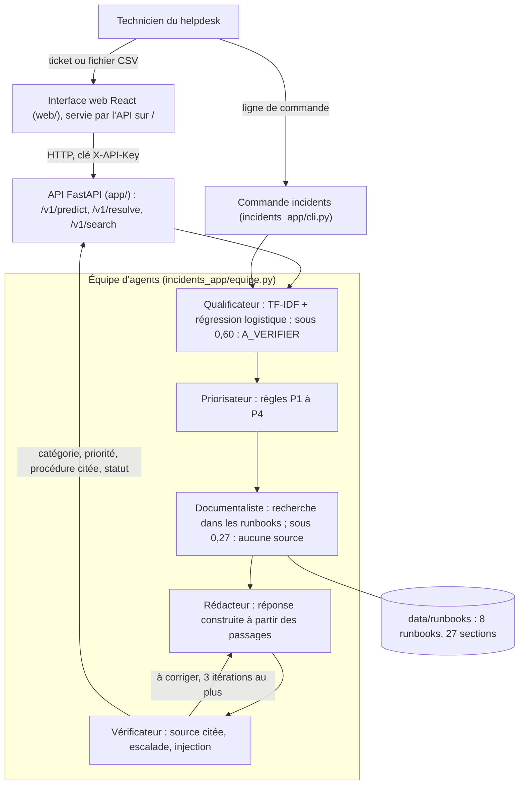

# Architecture

| Composant | Dossier | Push |
| --- | --- | --- |
| Commande `incidents` | `incidents_app/cli.py` | S1-4 (squelette), S2-1 (`predict`) |
| Modèle et prédiction | `src/train.py`, `incidents_app/predict.py` | S2-1 |
| Jeu d'or et évaluation | `tests/jeu_or.csv`, `src/evaluate.py` | S2-2 |
| API | `app/` | S2-3 |
| Interface web (React, Vite, TypeScript, Tailwind CSS) | `web/` | S2-4 |
| Runbooks, recherche, équipe d'agents | `data/runbooks/`, `incidents_app/` | S2-1 à S3-1 |
| Docker, installateur | `docker/`, `installateur/` | S3-3 |
