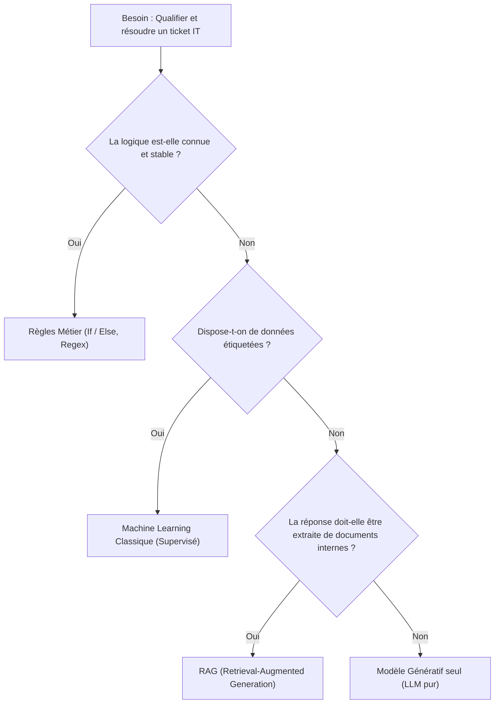

# Rapport de Cadrage et Conception : Méthode Initiale & Positionnement Scientifique

**Module :** Développement et déploiement d’applications intelligentes  
**Année universitaire :** 2026-2027  
**Enseignant :** M. A. Larhlimi  
**Équipe / Binôme :**  
- **Ishak Lamzouri** ([@inazuma2004](https://github.com/inazuma2004))
- **Ismail Amrani** ([@Amaranix](https://github.com/Amaranix))  
**Livrable :** Cadrage Initial & Étude de Conception (Semaine 1 - Base de l'évaluation 15%)  
**Dépôt GitHub officiel :** [https://github.com/inazuma2004/Lamzouri_Ishak-Amrani_Ismail_Projet20](https://github.com/inazuma2004/Lamzouri_Ishak-Amrani_Ismail_Projet20)

---

## 1. Contexte Métier & Définition du Problème

Dans les départements informatiques des moyennes et grandes organisations, les centres d'assistance (*IT Service Desk*) reçoivent chaque jour des centaines à des milliers de sollicitations d'utilisateurs formulées en langage naturel : dysfonctionnements matériels, pannes de réseau, blocages d'accès VPN ou requêtes logicielles.

Historiquement, le traitement de ces incidents souffre de plusieurs verrous majeurs :
1. **Routage manuel fastidieux et asynchrone :** Les techniciens de niveau 1 passent une part substantielle de leur temps à trier, classifier et réorienter les tickets vers les bonnes équipes de spécialistes.
2. **Délais de résolution élevés pour les pannes critiques :** Dans une file de traitement "premier arrivé, premier servi", un incident bloquant pour toute une division peut attendre plusieurs heures avant d'être seulement qualifié.
3. **Erreurs d'aiguillage récurrentes :** L'ambiguïté des formulations textuelles rédigées par des collaborateurs non-techniciens induit des erreurs d'attribution d'équipes, multipliant les allers-retours.

**Objectif du projet :** Concevoir, déployer et exploiter en production un **Agent Autonome de Résolution d'Incidents IT**, capable d'automatiser instantanément la qualification du problème, d'alerter les opérateurs humains en cas de doute, et d'interroger un index de procédures (**RAG extractif**, Semaines 9-10) pour fournir la résolution technique appropriée avec sa source.

---

## 2. Démarche Méthodologique & Arbre de Décision du Cours

Conformément à la pédagogie de M. Larhlimi, le cadrage d'une application intelligente exige de **justifier le choix de l'approche avant le choix de l'outil**, en descendant pas à pas dans l'arbre décisionnel officiel :



### Élimination des Approches Inadaptées au Démarrage :

1. **Pourquoi pas de simples Règles Métier (If/Else, Regex) ?**  
   Pour qu'un système à base de règles fonctionne, la logique métier doit être **totalement connue à l'avance et stable dans le temps**. Or, un même problème informatique peut être exprimé d'une infinité de manières selon le niveau technique de l'utilisateur (*"VPN ne marche pas"*, *"impossible de joindre le réseau entreprise à distance"*, *"erreur code 800 au login distant"*). L'arbre de règles deviendrait ingérable, fragile et incapable de généraliser.

2. **Pourquoi pas le RAG ou un LLM génératif pur dès la première étape ?**  
   Le RAG (*Retrieval-Augmented Generation*) excelle dans la synthèse de documents textuels longs (runbooks, fiches procédures). Cependant, avant de pouvoir rechercher une solution technique, le système doit impérativement **trier, filtrer et orienter l'incident vers le bon domaine** (Réseau, Matériel, Habilitation).  
   Utiliser un LLM génératif pur pour cette tâche de classification initiale enfreindrait les critères de latence et de coût : un appel API vers un modèle de type GPT-4 ou Claude coûte plusieurs centimes par requête et prend entre 1 et 3 secondes, là où une décision de routage doit être prise en quelques millisecondes à coût nul.  
   **Le RAG est donc réservé à l'étape de résolution** (section 6), pas au routage : le ML qualifie, le RAG documente.

### L'Approche Retenue : Machine Learning Supervisé (NLP Tabulaire)

Le socle de qualification d'incidents relève d'un problème de **classification de texte supervisée multiclasse**. Il satisfait rigoureusement les quatre critères cardinaux du cours :

| Critère Officiel du Cours | Situation de Notre Projet IT | Justification Scientifique & Métier |
| :--- | :--- | :--- |
| **(a) Données étiquetées** | **OUI (Disponible massivement)** | Le dataset Kaggle retenu (*IT Service Ticket Classification*) contient **47 837 tickets réels** déjà labellisés par les équipes d'assistance en 8 catégories techniques. |
| **(b) Vérifiabilité de la réponse** | **OUI (Audit des n-grammes)** | Le modèle statistique permet de mesurer objectivement sa performance sur un jeu de test disjoint ($F_1$-score macro, matrice de confusion) et d'auditer l'influence des mots-clés via les coefficients des n-grammes TF-IDF. |
| **(c) Coût par requête & Latence** | **NÉGLIGEABLE (< 5 ms)** | Un pipeline `TfidfVectorizer` + classifieur linéaire (`LogisticRegression` ou `LinearSVC`) s'exécute sur CPU standard en quelques millisecondes sans aucune dépendance à un GPU en production. Le coût d'infrastructure par requête est nul. |
| **(d) Conséquence d'une erreur** | **FAIBLE À MODÉRÉE** | Une mauvaise prédiction de routage ne détruit aucune donnée. L'impact est sécurisé dès l'interface grâce à un **seuil d'incertitude** (ex: confiance < 60%) réorientant automatiquement le ticket douteux vers une revue humaine. |

---

## 3. Le Dataset : IT Service Ticket Classification

* **Source :** Kaggle — [IT Service Ticket Classification Dataset](https://www.kaggle.com/datasets/adisongoh/it-service-ticket-classification-dataset) (Adison Goh).
* **Volumétrie :** 47 837 lignes, fichier `all_tickets_processed_improved_v3.csv` (~14.5 Mo).
* **Variables :**
  * `Document` ($X$) : Texte de la requête saisie par l'utilisateur.
  * `Topic_group` ($y$) : Cible multiclasse (8 classes : *Hardware, HR Support, Access, Miscellaneous, Storage, Purchase, Internal Project, Administrative rights*).
* **Conformité Syllabus :** Totalement gratuit, open source, exploitable sans GPU et exécutable en moins d'une minute sur un ordinateur portable d'étudiant ingénieur.

---

## 4. Architecture Logicielle & Roadmap Incrémentale (S1 à S11)

Conformément à la philosophie du cours (*"Le modèle est la plus petite boîte de l'application"* - Sculley et al., 2015), nous développons une application complète sur un **dépôt GitHub unique**, sans jamais jeter le code précédent :

```text
┌────────────────────────────────────────────────────────────────────────┐
│                        ARCHITECURE CIBLE (S11)                         │
│                                                                        │
│   Navigateur Utilisateur (Streamlit Web UI - S5)                       │
│        │                                                               │
│        ▼                                                               │
│   API REST FastAPI (Validation Pydantic /predict & /resolve - S3)      │
│        ├──> [Brique 1] Pipeline ML Supervisé (TF-IDF + Classifieur S2) │
│        │         └── Confiance > Seuil ? ──(Oui)──┐                   │
│        │                   │ (Non)                ▼                   │
│        │                   ▼           Agent Autonome (S10)            │
│        │            Alerte Humaine                │                    │
│        │                                          ▼                    │
│        └──> [Brique 2] Mini-RAG Local extractif (ChromaDB + runbooks)  │
│                         (S9-S10, sans LLM génératif)                   │
└────────────────────────────────────────────────────────────────────────┘
```

### Jalons du Projet :
1. **Semaine 1 (Cadrage & Dépôt) :** Validation de l'approche, vidéo de cadrage, conventions Git et structure de dossiers.
2. **Semaine 2 (Modèle Reproductible) :** Pipeline de prétraitement, découpage stratifié (80/20) strictement avant vectorisation, génération et versionnement de `models/metrics.json`.
3. **Semaine 3 (API REST FastAPI) :** Exposition du point de terminaison `/predict`, validation stricte des schémas JSON avec Pydantic.
4. **Semaine 4 (Qualité & Tests) :** Suite de tests unitaires et d'intégration avec `pytest`, typage (`mypy`) et linting (`ruff`).
5. **Semaine 5 (Interface Streamlit & Étude de Conception) :** Interface interactive avec jauge de confiance et alerte orange *"À vérifier par un technicien"* sous le seuil d'incertitude.
6. **Semaine 6 à 8 (MLOps, Docker & CI/CD) :** Packaging Python, conteneurisation Docker multi-services, pipelines GitHub Actions verts.
7. **Semaine 9 & 10 (RAG & IA Agentique) :** Indexation vectorielle des runbooks de dépannage et orchestration par l'agent autonome.
8. **Semaine 11 (Soutenance & Audit des Limites) :** Démonstration en direct et analyse critique du système.

---

## 5. Règles MLOps et Hygiène de Versionnement

1. **Séparation Stricte du Versionné / Non Versionné :**
   - **Versionné dans Git :** Le code source (`src/`, `app/`, `tests/`), les tests automatisés, les documentations (`docs/`), les configurations (`requirements.txt`, `.gitignore`) et le contrat de performance (`models/metrics.json`).
   - **Exclu de Git (`.gitignore`) :** L'environnement `.venv/`, les caches Python, les gros volumes de données brutes (`data/*.csv`) et les artefacts binaires compilés (`models/*.joblib`).
2. **Workflow Collaboratif :**
   - Aucune modification directe sur `main`.
   - Utilisation systématique de branches thématiques (`feat/...`, `fix/...`), relues par le binôme via Pull Request (PR) avant fusion.
3. **Traçabilité de la Vidéo de Cadrage :**
   - La vidéo réalisée par Ishak Lamzouri est intégrée dans le dossier `docs/media/` avec son script complet et accessible pour évaluation.

---

## 6. Défense du RAG extractif (Semaines 9-10)

> **Document détaillé :** [`docs/decisions/justification_rag.md`](../decisions/justification_rag.md). Cette section en reprend l'essentiel pour le rapport de cadrage.

### 6.1 Deux sous-problèmes, deux approches

Le projet ne se réduit pas à « choisir le RAG ». Il enchaîne deux décisions :

1. **Qualifier** le ticket : problème de classification de texte. Des données étiquetées existent (47 837 tickets) → **ML supervisé** (critère `a`).
2. **Résoudre** le ticket : problème de recherche documentaire. La réponse doit venir de runbooks internes et être vérifiable → **RAG** (critère `b`).

Le RAG n'est donc **pas** utilisé pour le routage. Il intervient uniquement après la qualification ML et après le seuil de confiance de 0,60.

### 6.2 Critère (b) : vérifiabilité

Chaque réponse `VALIDE` renvoie **le texte exact du runbook** et **le chemin de la source** (`data/runbooks/Access.md`), avec le score de similarité. Les runbooks sont versionnés dans Git. Le technicien peut ouvrir la source et vérifier chaque étape. Un modèle génératif seul ne garantit jamais qu'une commande ou un numéro d'étape existe réellement dans le document.

### 6.3 Critère (c) : coût par requête

Le RAG est **extractif** : ChromaDB + `sentence-transformers` (`all-MiniLM-L6-v2`) récupèrent le runbook, puis le texte est renvoyé **verbatim**. Aucune génération par LLM, donc aucun coût par token et aucun appel API payant.

| Mesure (09/11/2026, CPU, sans GPU) | Valeur |
| --- | --- |
| Latence RAG moyenne / p95 | **23,00 ms** / **25,36 ms** |
| Latence ML moyenne | **2,22 ms** |
| Runbooks indexés | **8** |
| Index ChromaDB | **21,90 Mo** |
| Cache du modèle d'embedding | **87,34 Mo** |
| Coût marginal par requête | **0 €** |

À 1 000 tickets/jour, le RAG consomme environ **23 secondes de CPU cumulées** ; à 10 000 tickets/jour, environ **4 minutes**. Aucun serveur dédié ni plateforme payante n'est nécessaire.

**Comparaison avec un LLM :** un appel génératif est facturé au token (entrée + sortie) et nécessite un réseau. Le cours (`cas2-reglement.md`) accepte ce coût pour « quelques dizaines de questions par jour » ; notre volume est de **centaines de tickets par jour**, donc le même raisonnement conduit à un RAG **sans génération**.

### 6.4 Pourquoi extractif plutôt que RAG + LLM

Un RAG classique ajoute une étape de génération : le LLM reformule le runbook. Cela réintroduit le coût par token, la latence réseau, la non-déterminisme et le risque d'hallucination. Pour une procédure opérationnelle qui doit être appliquée **à la lettre**, la citation verbatim est plus sûre qu'une synthèse. Nous conservons le **R** (retrieval) et remplaçons le **G** (generation) par une **extraction**.

### 6.5 Limites assumées

1. **Un runbook par catégorie :** avec le filtre `where={"categorie": ...}`, la recherche est proche d'un lookup ; le score de similarité est indicatif. Évolution prévue : découper les runbooks en passages et indexer plusieurs passages par catégorie.
2. **Modèle d'embedding anglais :** `all-MiniLM-L6-v2` est optimisé pour l'anglais, alors que les runbooks sont en français et les tickets en anglais. Évolution prévue : modèle multilingue ou runbooks en anglais.
3. **Index non reconstruit automatiquement :** il est reconstruit par `scripts/indexer_runbooks.py` après modification des runbooks.
4. **Pas de génération :** le RAG ne répond pas aux questions ouvertes absentes des runbooks ; l'agent renvoie alors `A_VERIFIER`.

### 6.6 Conclusion

Le RAG extractif est retenu pour la **résolution** parce qu'il est **vérifiable** (b) et **gratuit à la requête** (c), tout en respectant la contrainte « pas de plateforme payante, doit tourner sur un portable ». Le génératif seul est écarté. Le ML reste le moteur de qualification. Cette combinaison est conforme à l'arbre de décision du cours et ne saute aucune étape.
