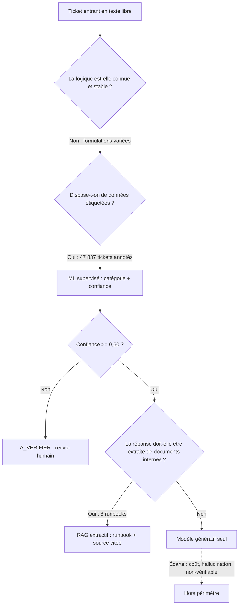

# Défense du choix RAG — Agent Autonome d'Incidents IT

> **Projet :** 20 — Agent Autonome de Résolution d'Incidents IT (IT Helpdesk Intelligent)
> **Binôme :** Ishak Lamzouri (Membre A) & Ismail Amrani (Membre B)
> **Rédacteur :** Ishak Lamzouri ([@inazuma2004](https://github.com/inazuma2004))
> **Relecteur :** Ismail Amrani ([@Amaranix](https://github.com/Amaranix))
> **Version :** 1.0 — 09/11/2026
> **Statut :** document de cadrage et de soutenance (à relire par le binôme)
> **Documents de cours utilisés :** `GRILLE-DE-DECISION.md`, `cas2-reglement.md`, `Dossier de lancement (semaine 1)`, `manuel-tp-volume1.pdf`, `CONTEXTE_SEANCE_09_11_2026.md`

---

## 1. Décision en une page

Notre application comporte **deux sous-problèmes distincts**, et nous appliquons l'arbre de décision du cours **séparément à chacun** :

| Sous-problème | Approche retenue | Pourquoi |
| --- | --- | --- |
| **Qualifier** un ticket (8 catégories) | **Machine Learning supervisé** (TF-IDF + LogisticRegression) | Des données étiquetées existent : 47 837 tickets annotés (critère **a**). |
| **Résoudre** le ticket (procédure de dépannage) | **RAG extractif local** (ChromaDB + `all-MiniLM-L6-v2`) | La réponse doit être extraite de runbooks internes et **vérifiable** (critère **b**) ; à notre volume, un modèle génératif coûterait trop cher (critère **c**). |
| **Générer** une réponse libre | **Aucun modèle génératif** | Coût par token, hallucination, non-vérifiabilité, données envoyées à un tiers. |

**Le RAG retenu est extractif :** il récupère le runbook pertinent et renvoie le texte **verbatim** avec sa source. Il n'y a **aucune génération par LLM**, donc **aucun coût par token** et **aucune hallucination possible par construction**.

**Chiffres mesurés le 09/11/2026 sur le portable de l'équipe (CPU, sans GPU) :**

| Indicateur | Valeur mesurée |
| --- | --- |
| Latence RAG moyenne | **23,00 ms** par requête |
| Latence RAG p95 | **25,36 ms** |
| Latence RAG min / max | 20,72 ms / 27,06 ms |
| Latence ML moyenne | **2,22 ms** par prédiction |
| Runbooks indexés | **8** (un par catégorie ML) |
| Taille de l'index ChromaDB | **21,90 Mo** |
| Cache du modèle d'embedding | **87,34 Mo** |
| Coût marginal par requête | **0 €** (aucun appel API, aucun token) |
| GPU requis | **Aucun** |

---

## 2. Le piège à éviter : « RAG » n'est pas une réponse unique

Le cours demande de choisir entre **règles métier**, **machine learning**, **RAG** et **modèle génératif seul**. Notre projet ne rentre pas dans une seule case parce qu'il enchaîne **deux décisions** :

1. **Router** le ticket vers la bonne catégorie (problème de classification de texte).
2. **Fournir** la procédure de dépannage correspondante (problème de recherche documentaire).

Utiliser un seul moteur pour les deux serait une erreur de cadrage :

- Un **LLM génératif seul** saurait rédiger une procédure plausible, mais **inventerait** des commandes, des numéros d'article ou des étapes absentes des runbooks. Il serait aussi facturé au token à chaque ticket.
- Un **classifieur ML seul** sait dire « catégorie = Access » mais **ne connaît pas** le contenu de la procédure Access.
- Un **RAG seul** pourrait retrouver un runbook, mais sans le filtre de catégorie il mélangerait des procédures proches (VPN, mot de passe, compte verrouillé) et serait moins précis.

**Notre choix : ML pour décider, RAG extractif pour documenter, humain pour arbitrer le doute.** C'est une combinaison conforme à l'arbre de décision, pas un contournement.

---

## 3. Arbre de décision appliqué aux deux sous-problèmes



| Étape de l'arbre | Question | Qualification du ticket | Résolution du ticket |
| --- | --- | --- | --- |
| 1 | Logique connue et stable ? | **Non** : un même incident est décrit de mille façons. | **Non** : les procédures évoluent et se chevauchent. |
| 2 | Données étiquetées ? | **Oui** : 47 837 tickets, 8 classes. → **ML**. | **Non** : aucune paire question/réponse annotée. |
| 3 | Réponse à extraire de documents ? | — | **Oui** : 8 runbooks Markdown versionnés. → **RAG**. |
| 4 | Modèle génératif seul ? | — | **Non** : coût par token et hallucination. |

> **Point clé pour l'oral :** nous ne « sautons » pas au RAG. Nous utilisons le ML là où les données étiquetées existent, et le RAG là où la réponse doit venir de documents. Le génératif seul n'est jamais utilisé.

---

## 4. Les quatre critères de la grille, appliqués au projet

### (a) Données étiquetées

- **Pour la classification :** le dataset Kaggle *IT Service Ticket Classification* fournit **47 837 tickets** déjà annotés en 8 catégories (`Document` → `Topic_group`). C'est ce qui rend le ML supervisé légitime.
- **Pour la résolution :** il n'existe **aucune base de paires « ticket → procédure »** annotées. Constituer un tel jeu demanderait des mois de travail de techniciens. Le RAG n'a pas besoin de ces annotations : il a besoin des **documents** (runbooks), qui existent déjà.
- **Conséquence :** le ML est le bon outil pour le routage ; il ne peut pas, à lui seul, produire une procédure.

### (b) Vérifiabilité — **critère principal de la défense**

- Chaque réponse RAG renvoie **le texte exact du runbook** et **le chemin de la source** (`data/runbooks/Access.md`), avec le score de similarité.
- Le runbook est **versionné dans Git** : on peut savoir quelle version a produit quelle réponse.
- Le technicien peut **ouvrir la source et vérifier** chaque étape avant de l'appliquer. La réponse n'est jamais une reformulation : c'est la procédure officielle.
- Un modèle génératif seul ne garantit **jamais** qu'une commande ou un numéro d'étape existe réellement dans le document. C'est précisément le risque que le critère (b) demande d'éliminer.

**Formulation pour l'oral :** *« Notre RAG ne dit pas “voici ce que je pense”, il dit “voici le runbook Access, ligne 12, voici le fichier source”. »*

### (c) Coût par requête — **critère principal de la défense**

- **Coût monétaire marginal : 0 €.** Tout tourne en local : ChromaDB sur disque, embeddings sur CPU, aucun appel à une API payante, aucun token facturé, aucun quota.
- **Coût machine mesuré : 23 ms de CPU par requête RAG** (p95 : 25,36 ms). Pour **1 000 tickets/jour**, cela représente **23 secondes de CPU cumulées**, soit moins de **0,03 % d'un cœur-jour**. Pour 10 000 tickets/jour : environ **4 minutes de CPU**.
- **Coût de stockage :** index ChromaDB **21,90 Mo** + cache du modèle **87,34 Mo**, soit environ **110 Mo** hors dépendances Python. Cela tient sur un portable.
- **Coût de construction de l'index :** ponctuel, lors de l'indexation des 8 runbooks ; il n'est pas payé à chaque requête.
- **Comparaison avec un LLM :** un appel à un modèle de langage est facturé **au token** (entrée + sortie) et nécessite un réseau. Le cours (`cas2-reglement.md`) accepte ce coût pour **« quelques dizaines de questions par jour »**. Notre volume est de **centaines de tickets par jour** : le même raisonnement conduit à une conclusion différente. C'est pour cela que nous avons choisi un RAG **sans génération**.

**Formulation pour l'oral :** *« Le RAG coûte cher quand on ajoute un LLM. Nous avons gardé le R — la recherche documentaire — et supprimé le G — la génération. Résultat : 23 ms, 0 €, et la source est citée. »*

### (d) Conséquence d'une erreur

- Une mauvaise procédure peut **aggraver l'incident** : mauvaise manipulation sur un disque, mauvaise réinitialisation de compte, perte de données, ou action contraire à la politique de sécurité.
- C'est pourquoi l'agent **ne résout jamais** un ticket dont le score ML est **< 0,60** : il renvoie `A_VERIFIER` à un technicien humain.
- Même au-dessus du seuil, la réponse affiche **la source** : le technicien garde la main et peut refuser la procédure proposée.
- Le RAG extractif réduit le risque à la **pertinence du document retrouvé**, pas à une invention du modèle.

---

## 5. Pourquoi pas un modèle génératif seul ?

| Critère | RAG extractif (retenu) | RAG + LLM génératif | LLM génératif seul |
| --- | --- | --- | --- |
| **Coût par requête** | **0 €** (CPU local) | Coût des tokens d'entrée (contexte) + sortie | Coût des tokens d'entrée + sortie |
| **Latence** | **23 ms** mesurés | Réseau + génération (ordre de la seconde) | Réseau + génération (ordre de la seconde) |
| **Vérifiabilité** | **100 %** : source + texte verbatim | Source citée, mais réponse reformulée | Aucune source garantie |
| **Hallucination** | **Nulle par construction** | Possible | Possible, voire probable sur des commandes techniques |
| **Données** | Restent **locales** | Envoyées au fournisseur | Envoyées au fournisseur |
| **Déterminisme** | Oui (même index + même requête) | Non | Non |
| **Fonctionne hors ligne** | **Oui** | Non (sauf LLM local) | Non (sauf LLM local) |
| **Volume supporté** | Élevé (centaines/jour) | Coût linéaire avec le volume | Coût linéaire avec le volume |

**Conclusion :** le génératif seul est écarté sur les critères **(b)** et **(c)**, et il introduit un risque **(d)** supplémentaire. Un RAG avec LLM serait plus défendable qu'un génératif seul, mais il réintroduit le coût par token et la reformulation. Pour un projet étudiant qui doit tourner sur un portable sans plateforme payante, le RAG **extractif** est le meilleur compromis.

---

## 6. Ce que « RAG extractif » veut dire exactement

Un RAG classique enchaîne :

```
Requête → Retrieval (documents) → Generation (LLM) → Réponse
```

Notre chaîne :

```
Requête → Retrieval (ChromaDB) → Extraction verbatim du runbook → Réponse + source
```

- Nous conservons **le R** (retrieval) : l'index vectoriel et la recherche par similarité.
- Nous remplaçons **le G** (generation) par une **extraction** : le texte du runbook est renvoyé tel quel.
- Ce n'est pas un raccourci technique : c'est un **choix de conception** adapté à une procédure opérationnelle qui doit être appliquée **à la lettre**. Reformuler une commande ou une étape serait un risque, pas une valeur ajoutée.

**Si demain** une synthèse est nécessaire (par exemple, résumer plusieurs runbooks pour un incident complexe), on pourra ajouter un **LLM local** (Ollama) derrière un drapeau, avec une évaluation dédiée du coût, de la latence et des hallucinations. Ce n'est **pas** dans le MVP, et ce ne serait jamais activé par défaut.

---

## 7. Protocole de mesure et résultats

### 7.1 Protocole

- **Machine :** portable de l'équipe, CPU uniquement, pas de GPU.
- **Environnement :** Python 3.13.9, `chromadb==1.5.9`, `sentence-transformers==6.2.0`, modèle `all-MiniLM-L6-v2`.
- **Corpus :** 8 runbooks Markdown, un document par runbook (pas de découpage en passages à ce stade).
- **Requêtes RAG :** 5 tickets représentatifs × 20 répétitions = **100 requêtes**, après préchargement du modèle (warm-up).
- **Requêtes ML :** 50 prédictions sur un ticket type.
- **Date :** 09/11/2026.

### 7.2 Résultats

| Mesure | Valeur |
| --- | --- |
| RAG — moyenne | **23,00 ms** |
| RAG — p95 | **25,36 ms** |
| RAG — min / max | 20,72 ms / 27,06 ms |
| ML — moyenne | **2,22 ms** |
| Documents indexés | **8** |
| Index ChromaDB | **21,90 Mo** |
| Cache MiniLM | **87,34 Mo** |
| Coût marginal | **0 €** |
| GPU | **aucun** |

### 7.3 Lecture des résultats

- Le RAG est **environ 10 fois plus lent** que le ML (23 ms vs 2,2 ms), mais reste **très en dessous** du seuil perceptible par un utilisateur (< 100 ms).
- Le coût dominant est le **chargement initial du modèle**, pas la requête. Une fois le modèle en mémoire, chaque requête est une opération CPU courte.
- Le coût de l'index est **fixe** : il ne dépend pas du nombre de tickets, seulement du nombre de runbooks.
- **À volume réaliste :** 1 000 tickets/jour = 23 s de CPU ; 10 000 tickets/jour = 230 s. Aucun serveur dédié n'est nécessaire.

### 7.4 Reproduire la mesure

```powershell
# 1. Indexer les runbooks
.venv\Scripts\python.exe -m incidents_app.rag --indexer

# 2. Tester une recherche
.venv\Scripts\python.exe -m incidents_app.rag --rechercher Access "cannot login vpn password expired"

# 3. Mesurer la latence (script utilisé pour les chiffres ci-dessus)
.venv\Scripts\python.exe -c "
import statistics, time
from incidents_app.rag import MiniRAG
rag = MiniRAG(); rag.charger_ou_indexer()
q = ('Access', 'cannot login vpn password expired account locked')
for _ in range(5): rag.rechercher(*q, k=1)  # warm-up
t = []
for _ in range(100):
    s = time.perf_counter(); rag.rechercher(*q, k=1); t.append((time.perf_counter()-s)*1000)
print('moyenne %.2f ms | p95 %.2f ms | docs %d' % (statistics.mean(t), sorted(t)[94], rag.compter()))
"
```

---

## 8. Limites assumées et évolutions

Un document de défense crédible doit dire **ce que le RAG ne fait pas encore**. Ces limites sont connues et documentées :

1. **Un seul runbook par catégorie.** Avec le filtre `where={"categorie": ...}`, la recherche retourne le runbook de la catégorie ; le score de similarité est donc **indicatif**. Le retrieval devient réellement discriminant quand plusieurs passages existent par catégorie (VPN, mot de passe, compte verrouillé, SSO…).
   - **Évolution prévue :** découper chaque runbook en passages (sections) et indexer plusieurs passages par catégorie. Le RAG choisira alors le **bon passage**, pas seulement le bon fichier.
2. **Modèle d'embedding anglais.** `all-MiniLM-L6-v2` est optimisé pour l'anglais, alors que les runbooks sont en français et les tickets du dataset en anglais. La similarité inter-langues est donc imparfaite.
   - **Évolution prévue :** passer à un modèle multilingue (`paraphrase-multilingual-MiniLM-L12-v2`) ou rédiger les runbooks en anglais pour aligner la langue.
3. **Longueur des documents.** Le modèle a une longueur d'entrée limitée ; un runbook long peut être tronqué à l'embedding. Le découpage en passages corrige aussi ce point.
4. **Index non reconstruit automatiquement.** L'index est reconstruit par `scripts/indexer_runbooks.py` (ou `python -m incidents_app.rag --indexer`) après modification des runbooks.
   - **Évolution prévue :** ajouter une étape d'indexation dans la CI ou dans le conteneur au démarrage.
5. **Pas de génération.** Le RAG ne répond pas aux questions ouvertes qui ne figurent dans aucun runbook ; dans ce cas, l'agent renvoie `A_VERIFIER` et un humain prend le relais.
6. **Pas d'exécution automatique.** Le runbook est une **recommandation** ; aucune commande n'est exécutée par l'agent. C'est une mesure de sécurité.

---

## 9. Ce que nous ne faisons pas (hors périmètre)

- Aucun appel à OpenAI, Anthropic, Google ou un autre LLM payant.
- Aucune recherche web : le RAG est strictement local et documentaire.
- Aucune donnée personnelle dans l'index : les runbooks sont des procédures internes, pas des tickets clients.
- Aucun *online learning* : le modèle ML n'apprend pas en production.
- Aucune exécution automatique des commandes du runbook.

---

## 10. Argumentaire de soutenance (30 secondes)

> « Nous avons deux problèmes, pas un. Pour **qualifier** le ticket, nous avons 47 837 tickets étiquetés : c'est du machine learning supervisé, 2 ms par prédiction. Pour **résoudre**, la réponse doit venir de nos runbooks internes et être vérifiable : c'est du RAG. Mais un RAG avec un LLM coûte des tokens à chaque ticket, et nous en avons des centaines par jour. Nous avons donc gardé la recherche documentaire et supprimé la génération : le runbook est renvoyé **verbatim**, avec sa source. Résultat : **23 ms, 0 € par requête, zéro hallucination possible**, et le technicien peut vérifier la source. En dessous de 60 % de confiance, l'agent ne résout pas : il passe la main à un humain. »

### Questions probables et réponses

**« Pourquoi ne pas utiliser ChatGPT/Claude pour rédiger la procédure ? »**
Parce que le coût est proportionnel au nombre de tickets, que la réponse serait une reformulation non garantie, et que les données sortiraient de l'établissement. Le runbook doit être appliqué à la lettre : la citation verbatim est plus sûre qu'une synthèse.

**« Votre RAG ne fait qu'un dictionnaire catégorie → fichier, non ? »**
Aujourd'hui, avec un runbook par catégorie, le filtre de catégorie rend la recherche proche d'un lookup. C'est assumé et documenté. La valeur du RAG est déjà là : la réponse est **ancrée dans un document versionné et cité**, pas générée. L'étape suivante est de découper les runbooks en passages pour que le retrieval choisisse le bon **passage** à l'intérieur de la catégorie. Le score de similarité et l'index vectoriel sont déjà en place pour cela.

**« Combien coûte une requête ? »**
0 € en marginal : pas d'API, pas de token. 23 ms de CPU, 22 Mo d'index, 87 Mo de modèle. 1 000 tickets/jour = 23 secondes de CPU cumulées. Le seul coût est le portable qui existe déjà.

**« Que se passe-t-il si le runbook est faux ou obsolète ? »**
Le runbook est versionné dans Git ; une modification est tracée. L'index doit être reconstruit après modification (script dédié). La source est affichée, donc le technicien voit immédiatement la version utilisée. C'est un processus humain de maintenance documentaire, pas une vérité automatique.

**« Pourquoi le seuil de 60 % ? »**
C'est le seuil du cours. Il est appliqué à la **confiance du ML**, pas au score RAG. En dessous, l'agent ne résout pas et renvoie `A_VERIFIER`. Les tests vérifient ce comportement.

---

## 11. Références internes

- `incidents_app/rag.py` — implémentation du Mini-RAG (ChromaDB, embeddings, filtre par catégorie).
- `incidents_app/agent.py` — orchestration ML → RAG → réponse, seuil 0,60.
- `scripts/indexer_runbooks.py` — indexation des runbooks.
- `data/runbooks/*.md` — 8 runbooks versionnés.
- `docs/architecture_agent.md` — architecture agentique.
- `docs/semaine1/1-descriptif.md` — descriptif du projet et métrique de succès.
- `tests/test_rag.py`, `tests/test_agent.py` — preuves automatisées (source citée, abstention, pas de génératif seul).

## 12. Références du cours

- `GRILLE-DE-DECISION.md` — les quatre critères (a), (b), (c), (d) et l'arbre de choix.
- `cas2-reglement.md` — exemple de fiche RAG : vérifiabilité et coût par requête.
- `cas3-avis-negatifs.md` — exemple de fiche ML : données étiquetées et coût par requête.
- `Dossier de lancement (semaine 1)` — exigences des quatre livrables.
- `manuel-tp-volume1.pdf` — Atelier 0 (cadrage) et TP1 à TP4.
- `CONTEXTE_SEANCE_09_11_2026.md` — synthèse des ressources du 09/11/2026.

---

*Document rédigé pour la soutenance et la revue du binôme. Les chiffres sont des mesures locales, reproductibles avec les commandes de la section 7.4 ; ils ne sont pas des estimations.*
