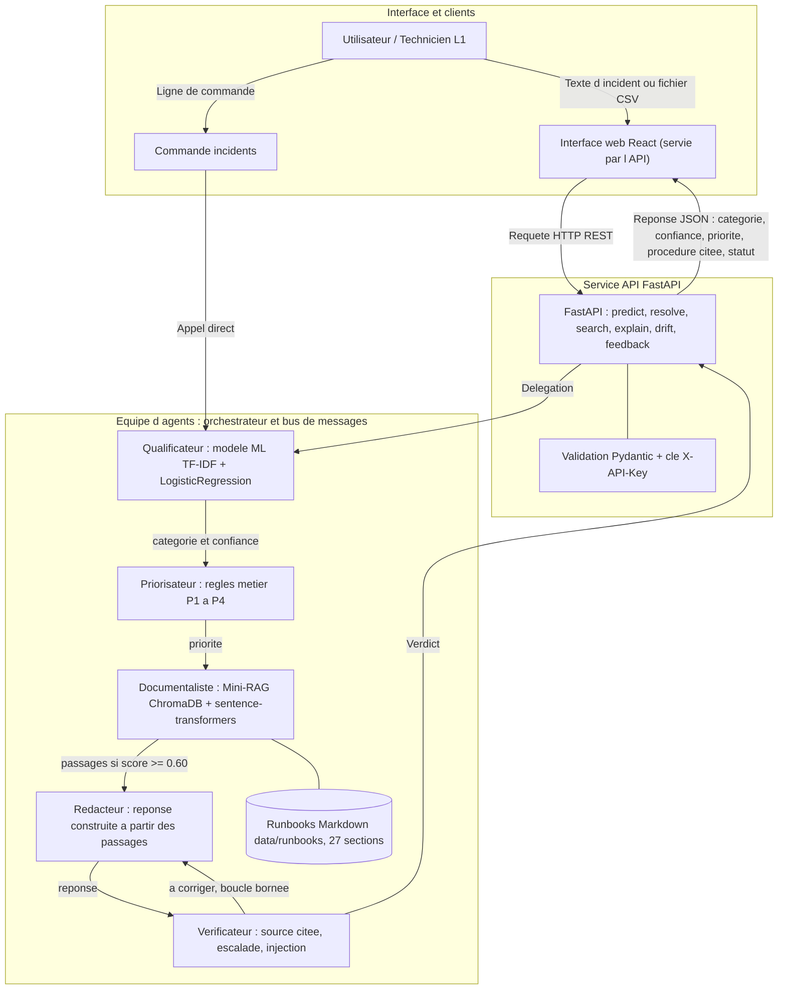
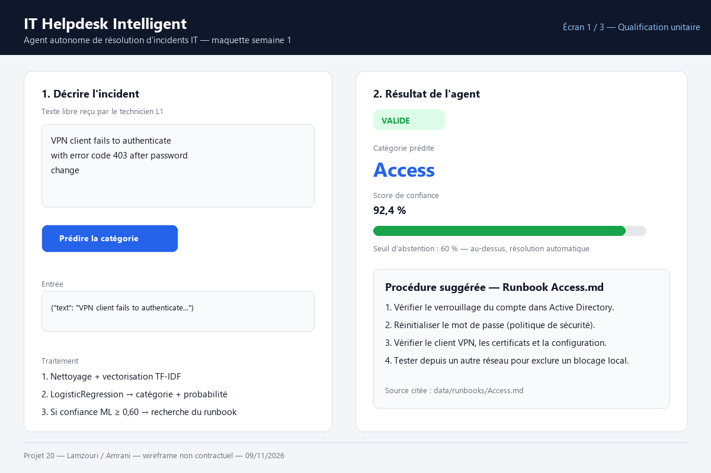
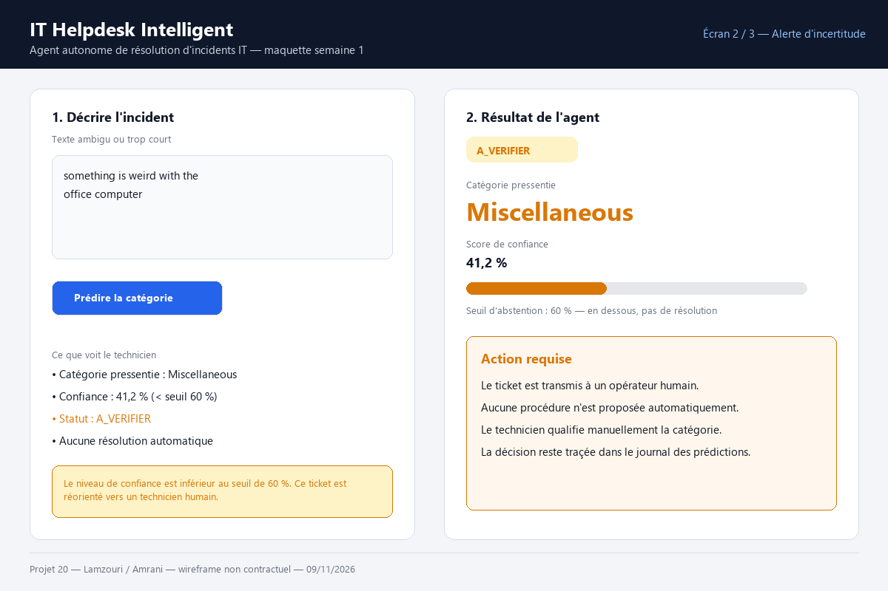
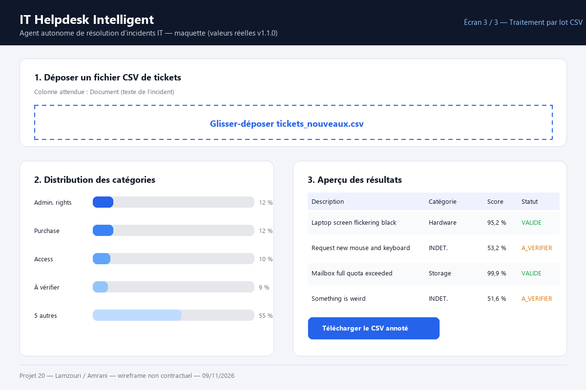

# Livrable 3 : Maquette globale

**Rédacteur :** Ishak Lamzouri ([@inazuma2004](https://github.com/inazuma2004))  
**Relecteur :** Ismail Amrani ([@Amaranix](https://github.com/Amaranix))  
**Fichiers :** `docs/semaine1/3-maquette.md` + `docs/semaine1/img/` (3 wireframes PNG)

> Les wireframes PNG sont régénérables avec `python scripts/generer_wireframes.py`. Les blocs ASCII ci-dessous en sont la version texte, lisible directement dans le Markdown. Les valeurs affichées (catégories, scores, priorités, sections citées) sont celles que renvoie réellement l'application (version 1.1.0) pour ces tickets.

---

## 3.1 Schéma d'architecture globale



---

## 3.2 Légende du schéma

| Composant | Rôle et technologies | Fonctionnalité servie |
| --- | --- | --- |
| **Interface web (React)** | Cinq écrans : ticket, traitement par lot CSV, procédures, supervision des tickets à vérifier, modèle et mesures. Servie par l'API sur le port 8000, elle ne parle qu'à elle. | F2, F3 |
| **Commande `incidents`** | `predict`, `resolve`, `index`, `serve`, `ui` : usage en terminal ou dans des scripts. | F1, F3 |
| **API FastAPI** | Routes protégées par clé d'API, validation Pydantic, journal sans texte de ticket. | F3 |
| **Qualificateur (modèle ML)** | Pipeline scikit-learn TF-IDF + régression logistique, seuil d'abstention 0,60. | F1, F2 |
| **Priorisateur** | Règles métier explicables : P1 (sécurité, panne générale) à P4 (demande planifiable). | F1 |
| **Documentaliste (Mini-RAG)** | Recherche hybride dans ChromaDB, citation « document > section », refus sous le seuil. | F4 |
| **Rédacteur et Vérificateur** | Réponse construite uniquement à partir des passages ; contrôle de la source, de l'escalade et de l'injection ; boucle bornée. | F2, F4 |

---

## 3.3 Maquette des écrans (interface web React)

### Écran 1 : Qualification et résolution d'un incident



```text
┌────────────────────────────────────────────────────────────────────────┐
│ 🎫 Nouveau ticket                                                      │
├────────────────────────────────────────────────────────────────────────┤
│ Description de l'incident (en anglais) :                               │
│ ┌────────────────────────────────────────────────────────────────────┐ │
│ │ Cannot connect to the VPN since this morning, my password expired  │ │
│ └────────────────────────────────────────────────────────────────────┘ │
│ [ 🚀 Lancer l'équipe d'agents ]                                       │
│                                                                        │
│ Catégorie : Access   Confiance : 88,1 % ████████████████░░   P2       │
│ Statut : ✅ VALIDE                                                     │
│                                                                        │
│ Procédure : Connexion VPN impossible                                   │
│ > 1. Vérifier que le client VPN est à jour et que le poste a accès à   │
│ >    Internet.                                                         │
│ > 2. Contrôler la validité du certificat machine et la date système.   │
│ > ...                                                                  │
│ > Escalade : équipe Identité et sécurité, sous 4 h ouvrées.            │
│ 📎 Source citée : Access.md > Connexion VPN impossible                 │
└────────────────────────────────────────────────────────────────────────┘
```

### Écran 2 : Alerte d'incertitude (Gestion de l'abstention)



```text
┌────────────────────────────────────────────────────────────────────────┐
│ Résultat pour : "Cannot access the shared network drive after my       │
│                  password change"                                      │
│                                                                        │
│ • Catégorie : INDETERMINE                                              │
│ • Score de confiance : 53,1 %   ██████████░░░░░░░░░░   priorité P2     │
│ • Statut : ⚠️ À VÉRIFIER                                               │
│                                                                        │
│ ⚠️ Ticket transmis à un technicien (confiance du modèle sous le seuil).│
│ Bonne catégorie : [ Storage ▼ ]   [ Envoyer la correction ]            │
└────────────────────────────────────────────────────────────────────────┘
```

### Écran 3 : Traitement par lot (Fichier CSV)



```text
┌────────────────────────────────────────────────────────────────────────┐
│ 📁 Traitement par lot                                                  │
│ Déposez votre fichier CSV contenant une colonne 'Document' :          │
│ [ 📄 Glisser-déposer tickets_nouveaux.csv ici ]                       │
│                                                                        │
│ Tickets : 120   Traités automatiquement : 109   À vérifier : 11       │
│ Répartition des catégories (graphique) · confiance (histogramme)       │
│ Dérive : mots inconnus, confiance moyenne, taux d'abstention           │
│                                                                        │
│ ┌────────────────────────────────────────┬─────────────┬─────────┬───┐│
│ │ Description                            │ Catégorie   │ Score   │St ││
│ ├────────────────────────────────────────┼─────────────┼─────────┼───┤│
│ │ Laptop screen flickering black         │ Hardware    │ 95,2%   │OK ││
│ │ Request new mouse and keyboard         │ INDETERMINE │ 53,2%   │ ⚠ ││
│ │ Mailbox full quota exceeded            │ Storage     │ 99,9%   │OK ││
│ └────────────────────────────────────────┴─────────────┴─────────┴───┘│
│ [ ⬇️ Télécharger le CSV annoté ]                                       │
└────────────────────────────────────────────────────────────────────────┘
```

---

## 3.4 Parcours utilisateur

1. **Scénario nominal unitaire :**
   - Le technicien L1 ouvre l'interface web (http://localhost:8000/) et saisit sa clé d'API.
   - Il colle la description reçue d'un utilisateur dans la zone de texte, en anglais.
   - Il clique sur *« Lancer l'équipe d'agents »*.
   - L'écran affiche la catégorie (`Access`), la confiance (88 %), la priorité (`P2`), le badge `VALIDE` et la procédure de la section « Access.md > Connexion VPN impossible », avec sa source et l'équipe d'escalade. Le journal des agents montre que le Vérificateur a fait ajouter l'escalade (2 itérations).
2. **Scénario d'incertitude :**
   - Le texte saisi est ambigu, ou rédigé dans une autre langue que l'anglais.
   - Le score calculé est de 53 % (< 60 %), ou le ticket est détecté comme non anglais.
   - L'écran affiche une alerte orange `À VÉRIFIER`, sans procédure ni source ; le technicien choisit la bonne catégorie et envoie la correction, qui servira au prochain réentraînement.
3. **Scénario de traitement par lot :**
   - L'administrateur charge un export CSV de tickets.
   - L'application qualifie tout le fichier en un appel, affiche la répartition, la confiance et les indicateurs de dérive ; si la colonne `Topic_group` est présente, elle mesure aussi la justesse.
   - L'utilisateur télécharge le fichier annoté avec les colonnes `label`, `score`, `status` et `raison`.

---

## Critères d'acceptation (vérifiés par le relecteur)

- [x] Chaque composant du livrable 1 apparaît dans le schéma d'architecture.
- [x] Le flux complet d'une requête est traçable de bout en bout.
- [x] Chaque fonctionnalité du MVP est illustrée sur au moins une maquette d'écran.
- [x] Le diagramme Mermaid est valide et s'affiche nativement sur GitHub.
- [x] Les cas d'erreur et d'incertitude sont explicitement traités visuellement.
