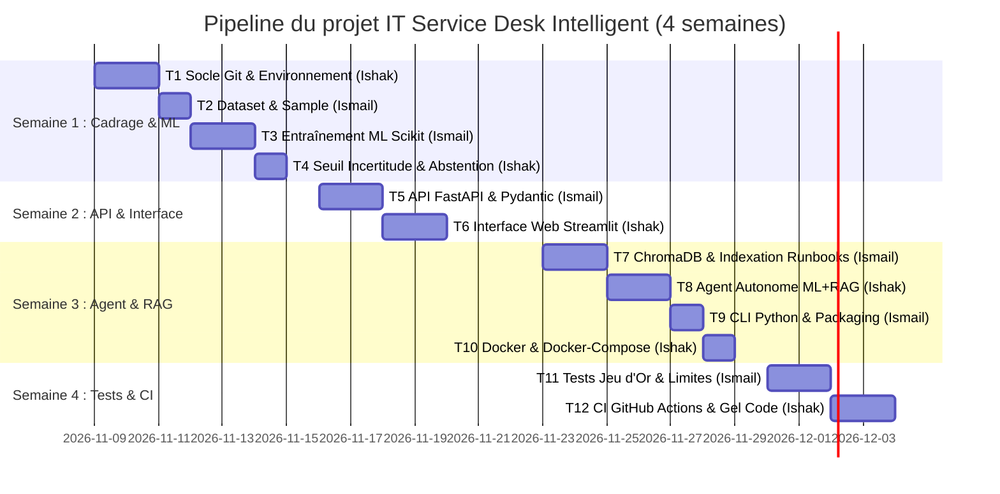

# Livrable 4 : Pipeline des tâches prévues

**Consolidateur :** Ismail Amrani ([@Amaranix](https://github.com/Amaranix))  
**Relecteur :** Ishak Lamzouri ([@inazuma2004](https://github.com/inazuma2004))  
**Fichier :** `docs/semaine1/4-pipeline.md`

---

## 4.1 Liste des tâches découpées (Tâches de 1 à 2 jours)

| ID | Tâche | Fonctionnalité | Responsable | Dépend de | Semaine | Terminée quand ? (Critère vérifiable) |
| --- | --- | --- | --- | --- | --- | --- |
| **T1** | Initialisation du dépôt, configuration Git, `pre-commit`, `.editorconfig` et conventions | Socle commun | Ishak Lamzouri | - | S1 | Le dépôt est clonable, les hooks pre-commit s'exécutent sans erreur. |
| **T2** | Ingestion des données, analyse exploratoire et extraction de `data/sample/tickets_sample.csv` | Socle données | Ismail Amrani | T1 | S1 | Le sample de 120 lignes est validé et s'ouvre sous pandas sans erreur. |
| **T3** | Entraînement du pipeline Scikit-learn (TF-IDF + LogisticRegression) et sérialisation | F1 | Ismail Amrani | T2 | S1 | Le modèle atteint F1-macro >= 0.85 et le fichier `.joblib` est généré. |
| **T4** | Implémentation de la règle de confiance et seuil d'incertitude (60%) | F2 | Ishak Lamzouri | T3 | S1 | Le script renvoie le statut `VALIDE` ou `A_VERIFIER` selon la probabilité. |
| **T5** | Développement de l'API REST FastAPI avec schémas Pydantic (`/predict`, `/health`) | F3 | Ismail Amrani | T4 | S2 | Les requêtes HTTP POST sur `/predict` renvoient un code 200 et un JSON conforme. |
| **T6** | Construction de l'interface utilisateur Streamlit (saisie unitaire + lot CSV) | F3 | Ishak Lamzouri | T5 | S2 | L'application Web Streamlit permet de tester un ticket et de charger un CSV. |
| **T7** | Mise en place de la base vectorielle ChromaDB et indexation des runbooks Markdown | F4 | Ismail Amrani | T5 | S3 | Une requête de test renvoie le runbook pertinent en moins d'une seconde. |
| **T8** | Création de l'agent autonome de résolution combinant ML et RAG | F4 | Ishak Lamzouri | T7 | S3 | L'agent produit une qualification + une citation de runbook vérifiable. |
| **T9** | Développement du CLI Python (`incidents`) et empaquetage `pyproject.toml` | F1, F3 | Ismail Amrani | T8 | S3 | La commande `incidents "panne écran"` s'exécute directement dans le terminal. |
| **T10** | Conteneurisation multi-services avec Docker et `docker-compose.yml` | Déploiement | Ishak Lamzouri | T6, T9 | S3 | `docker compose up` lance l'API et l'UI sans configuration manuelle. |
| **T11** | Élaboration de la suite de tests complète (unitaires, intégration, jeu d'or, limites) | Qualité | Ismail Amrani | T10 | S4 | `pytest` valide au moins 25 tests avec 0 échec bloquant. |
| **T12** | Pipeline CI GitHub Actions (`ruff`, `mypy`, `pytest`) et dossier final | Qualité | Ishak Lamzouri | T11 | S4 | La CI GitHub Actions passe au vert sur la branche principale `main`. |

---

## 4.2 Jalons hebdomadaires

| Semaine | Jalon démontrable | Tâches associées |
| --- | --- | --- |
| **Semaine 1** | Dossier de lancement validé, échantillon `data/sample/`, prototype ML opérationnel en script. | T1, T2, T3, T4 |
| **Semaine 2** | API REST FastAPI exposée et documentée Swagger, interface Streamlit fonctionnelle. | T5, T6 |
| **Semaine 3** | Mini-RAG local intégré, agent autonome opérationnel, conteneurisation Docker au point. | T7, T8, T9, T10 |
| **Semaine 4** | Suite de tests d'or et limites validée, CI GitHub Actions au vert, code gelé et livrable final. | T11, T12 |

---

## 4.3 Vue chronologique (Diagramme de Gantt)

---

## 4.4 Chemin critique et charge de travail

- **Chemin critique :** `T1` ➔ `T2` ➔ `T3` ➔ `T5` ➔ `T6` ➔ `T8` ➔ `T10` ➔ `T11` ➔ `T12`.  
  *Justification :* Toute indisponibilité du modèle ML (T3) retarde l'API (T5), qui conditionne l'interface (T6), l'orchestration agentique (T8), puis les conteneurs et les tests finaux.
- **Équilibre de charge par membre :**
  - **Ishak Lamzouri (Membre A) :** T1 (2j) + T4 (1j) + T6 (2j) + T8 (2j) + T10 (1j) + T12 (2j) = **10 jours**.
  - **Ismail Amrani (Membre B) :** T2 (1j) + T3 (2j) + T5 (2j) + T7 (2j) + T9 (1j) + T11 (2j) = **10 jours**.
  - **Écart de charge :** 0 jour (parfaite équité et symétrie des contributions).

---

## Critères d'acceptation (vérifiés par le relecteur)

- [x] Aucune tâche ne dépasse 2 jours de charge unitaire.
- [x] Chaque fonctionnalité du MVP est couverte par au moins une tâche.
- [x] Chaque tâche possède un critère de fin vérifiable et objectif.
- [x] Le MVP est finalisé avant la fin de la semaine 3.
- [x] La charge est équilibrée entre les deux membres du binôme (écart nul).
- [x] Les jalons hebdomadaires sont démontrables.

