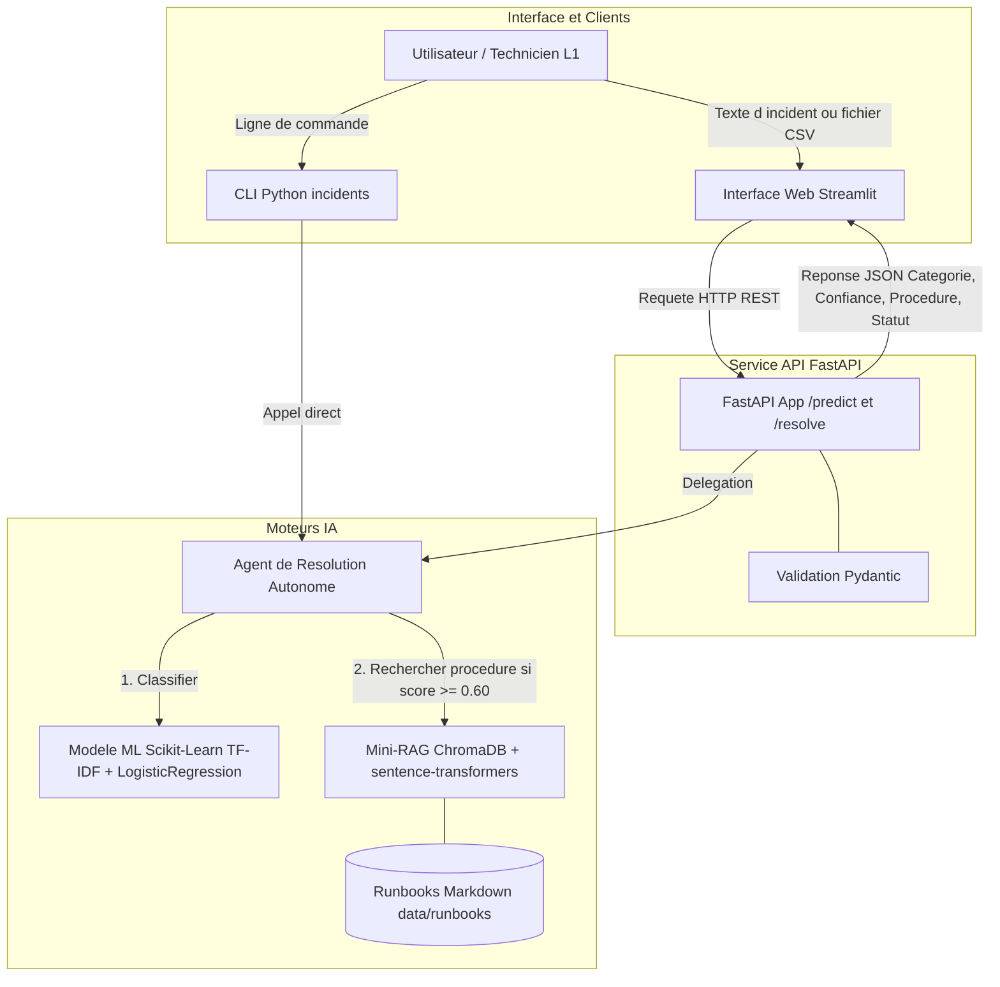
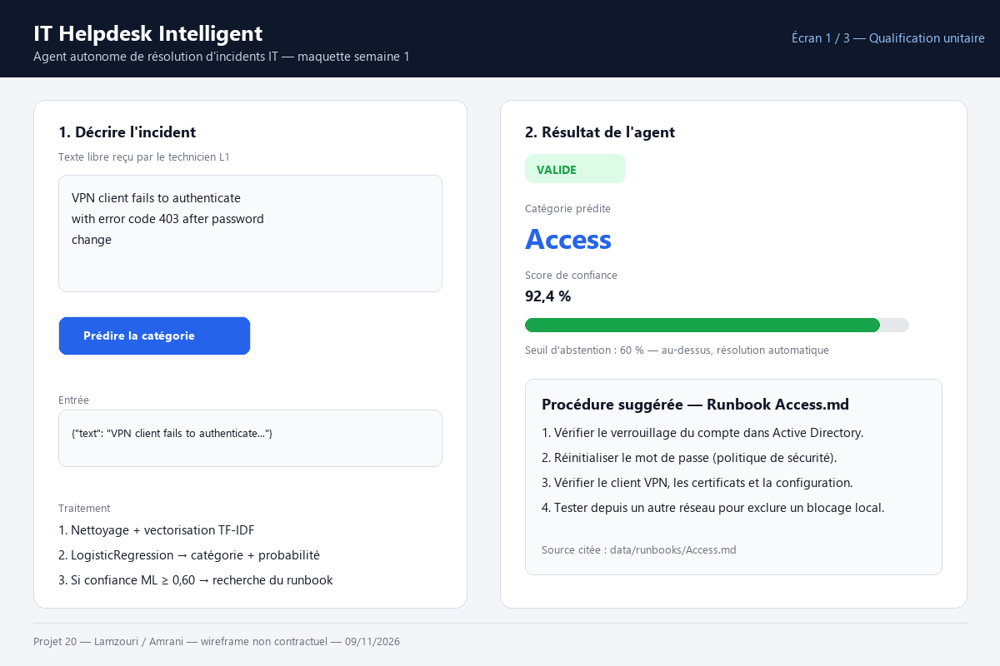
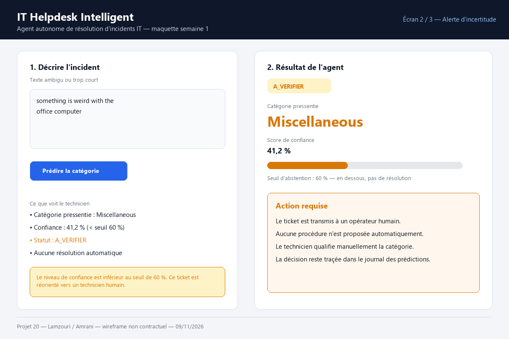
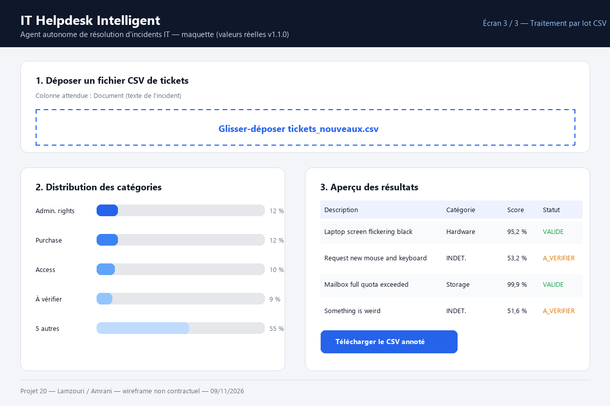
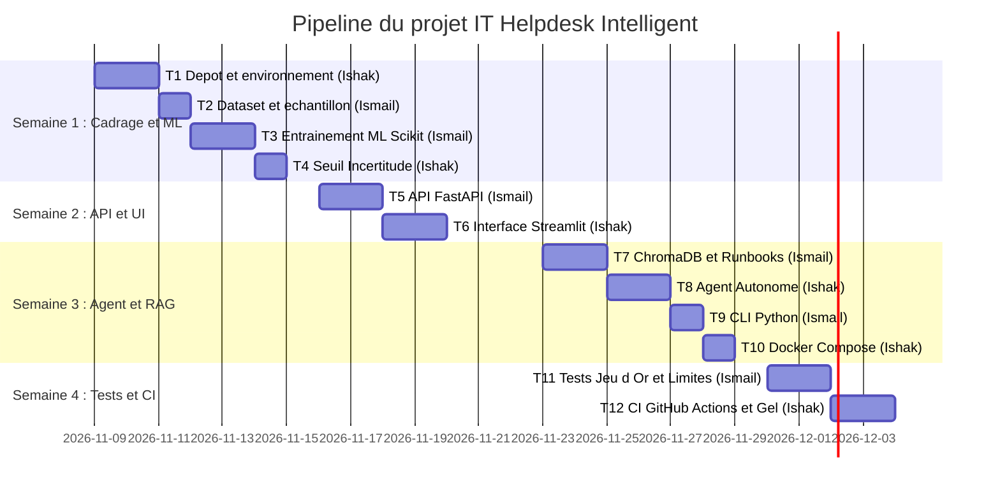

# Dossier de lancement (semaine 1)

**Date :** 09 Novembre 2026 · @Larhlimi  
**Module :** Développement et déploiement d’applications intelligentes (2026-2027)  
**Intitulé du projet :** Agent Autonome de Résolution d'Incidents IT (IT Helpdesk Intelligent)  
**Dépôt GitHub :** [https://github.com/inazuma2004/Lamzouri_Ishak-Amrani_Ismail_Projet20](https://github.com/inazuma2004/Lamzouri_Ishak-Amrani_Ismail_Projet20)  

---

## Mode d'emploi

La semaine 1 est décisive : sur un projet de 4 semaines, un cadrage flou ou des données indisponibles ne se rattrapent pas. Ce dossier permet à l'enseignant de valider, faire reprendre ou refuser le projet sous 48 heures.

Le dossier comporte quatre livrables. L'équipe se les répartit : chaque membre rédige seul le ou les livrables dont il est responsable, puis un autre membre le relit. Le nom du rédacteur et du relecteur figure en tête de chaque livrable ; c'est une preuve de contribution pour la note individuelle.

**Notre répartition (Binôme de 2 étudiants)**

| Livrable | Rédacteur | Relecteur | Fichier dans le dépôt |
| --- | --- | --- | --- |
| **1. Descriptif du projet** | Ishak Lamzouri ([@inazuma2004](https://github.com/inazuma2004)) | Ismail Amrani ([@Amaranix](https://github.com/Amaranix)) | `docs/semaine1/1-descriptif.md` |
| **2. Dataset** | Ismail Amrani ([@Amaranix](https://github.com/Amaranix)) | Ishak Lamzouri ([@inazuma2004](https://github.com/inazuma2004)) | `docs/semaine1/2-dataset.md` + `data/sample/` |
| **3. Maquette globale** | Ishak Lamzouri ([@inazuma2004](https://github.com/inazuma2004)) | Ismail Amrani ([@Amaranix](https://github.com/Amaranix)) | `docs/semaine1/3-maquette.md` + `docs/semaine1/img/` |
| **4. Pipeline des tâches** | Ismail Amrani ([@Amaranix](https://github.com/Amaranix)) | Ishak Lamzouri ([@inazuma2004](https://github.com/inazuma2004)) | `docs/semaine1/4-pipeline.md` |

**Circuit GitHub**

1. Le coordinateur a créé le dossier `docs/semaine1/` avec un `README.md` reprenant le tableau de répartition.
2. Chaque rédacteur a pris en charge ses sections spécifiques.
3. Chaque livrable a été relu et validé selon les critères d'acceptation du cours.
4. L'échantillon de données `data/sample/tickets_sample.csv` est versionné dans Git.
5. Les tâches et jalons hebdomadaires sont structurés et traçables.

---

## Livrable 1 : Descriptif du projet mis à jour

**Rédacteur :** Ishak Lamzouri   **Relecteur :** Ismail Amrani   **Fichier :** `docs/semaine1/1-descriptif.md`

### 1.1 Contexte et problème
Dans les centres d'assistance informatique (IT Service Desk), des centaines de tickets d'incidents arrivent quotidiennement rédigés en langage naturel. Le traitement actuel est manuel : un technicien de niveau 1 lit chaque ticket, en détermine la catégorie (matériel, accès, droits, réseau, etc.) et l'aiguille manuellement. Ce processus est lent (plusieurs heures à jours d'attente), coûteux et engendre des erreurs récurrentes de routage.

### 1.2 Objectif en une phrase
Classifier automatiquement les tickets d'incidents informatiques avec un score de confiance et assister leur résolution via des procédures techniques indexées, tout en déléguant à l'humain dès que le niveau de certitude est insuffisant.

### 1.3 Utilisateurs cibles et scénario d'usage principal
- **Utilisateurs cibles :** Techniciens de support IT niveau 1 (gain de temps) et collaborateurs d'entreprise déclarant un incident.
- **Scénario d'usage principal :**
  1. L'utilisateur saisit sa demande en texte libre (ex. : *"Impossible d'accéder au lecteur réseau partagé après changement de mot de passe"*).
  2. L'agent analyse le texte en quelques millisecondes et prédit la catégorie `Storage` avec 89% de confiance.
  3. Le score étant supérieur au seuil de 60%, l'agent valide la catégorie (`VALIDE`) et extrait la procédure de reconnexion réseau du runbook correspondant.
  4. L'utilisateur reçoit la solution immédiatement ; si le score avait été inférieur à 60%, le ticket aurait été marqué `A_VERIFIER` et transmis à un opérateur humain.

### 1.4 Fonctionnalités du MVP (Équipe de 2 étudiants)

| N° | Fonctionnalité | Ce que l'utilisateur voit ou obtient | Priorité |
| --- | --- | --- | --- |
| **F1** | Classification automatique supervisée en 8 catégories | Prédiction instantanée de la catégorie avec score de confiance calculé en probabilités. | Indispensable |
| **F2** | Gestion de l'incertitude et abstention automatique | Statut `VALIDE` si confiance >= 60%, ou statut `A_VERIFIER` avec avertissement explicite. | Indispensable |
| **F3** | API REST FastAPI et Interface Web Streamlit | Endpoints d'inférence `/predict` et interface interactive avec saisie unitaire et lot CSV. | Indispensable |
| **F4** | Moteur Mini-RAG local branché sur runbooks | Suggestions d'étapes de dépannage issues des runbooks officiels avec citation de la source. | Souhaitable |

### 1.5 Services et composants techniques

| Service ou composant | Rôle dans le projet | Technologie choisie | Pourquoi ce choix |
| --- | --- | --- | --- |
| **Modèle ML** | Classification supervisée de texte | Scikit-learn (`TfidfVectorizer` + `LogisticRegression`) | Moins de 10 ms par prédiction, très faible empreinte mémoire, tourne sans GPU sur ordinateur portable. |
| **Recherche ou mémoire** | Base vectorielle de runbooks techniques | ChromaDB locale + `sentence-transformers` | Recherche sémantique locale gratuite, sans coût récurrent d'API et sans dépendance externe. |
| **Outils appelés par l'agent** | CLI d'administration et scripts batch | CLI Python (`incidents`) | Utilisation directe en terminal et intégration simple dans des scripts d'exploitation. |
| **API** | Exposition des prédictions et résolutions | FastAPI + Uvicorn + Pydantic v2 | Standard OpenAPI/Swagger, validation stricte des entrées/sorties et haute performance asynchrone. |
| **Interface** | Dashboard utilisateur et analyse par lot | Streamlit | Prototypage rapide, affichage de graphiques de distribution et export direct des CSV enrichis. |
| **Conteneur et CI** | Reproductibilité et validation continue | Docker, Docker Compose, GitHub Actions | Environnement hermétique et tests automatisés (ruff, mypy, pytest) à chaque commit. |

### 1.6 Hors périmètre
- Appel à des modèles de langage propriétaires payants (OpenAI GPT-4, Claude).
- Intégration directe aux API cloud propriétaires de ServiceNow ou Jira Service Management.
- Alerting push automatisé par SMS ou appels téléphoniques.
- Entraînement en ligne continu en production (*online learning*).

### 1.7 Écart avec la fiche du catalogue
Nous avons étendu la classification supervisée du catalogue en intégrant un module **Mini-RAG local** alimenté par des runbooks d'incidents IT. Cela permet à l'agent d'ajouter à la catégorisation une aide concrète au dépannage avec citations traçables des procédures.

**Critères d'acceptation (vérifiés par le relecteur)**
- [x] Le problème et l'utilisateur sont compréhensibles sans le catalogue.
- [x] Le nombre de fonctionnalités correspond à la taille de l'équipe (binôme).
- [x] Chaque fonctionnalité est démontrable.
- [x] Chaque composant technique a une justification claire.
- [x] Le hors périmètre est formellement rempli.

---

## Livrable 2 : Dataset

**Rédacteur :** Ismail Amrani   **Relecteur :** Ishak Lamzouri   **Fichiers :** `docs/semaine1/2-dataset.md` + `data/sample/tickets_sample.csv`

### 2.1 Description

| Rubrique | Réponse |
| --- | --- |
| **Nom et source (lien)** | `all_tickets_processed_improved_v3.csv` — [Kaggle IT Service Ticket Classification Dataset](https://www.kaggle.com/datasets/adisongoh/it-service-ticket-classification-dataset) |
| **Producteur ou propriétaire** | Adison Goh (données de tickets d'assistance IT d'entreprise réelles et anonymisées) |
| **Volume** | 47 837 lignes, 2 colonnes, environ 14.5 Mo |
| **Format et structure** | CSV UTF-8. Colonnes : `Document` (description brute de l'incident), `Topic_group` (classe cible) |
| **Langue et période couverte** | Anglais technique d'entreprise |
| **Licence et droits d'usage** | CC0 : Domaine Public (usage libre académique et commercial) |
| **Données personnelles ou sensibles** | Aucune : anonymisation complète réalisée en amont (aucun nom, email ou IP réelle) |
| **Emplacement des données complètes** | Racine locale du projet : `data/all_tickets_processed_improved_v3.csv` |

### 2.2 Qualité constatée sur l'échantillon
Inspection de `data/sample/tickets_sample.csv` (120 lignes, 15 par catégorie) :
- Zéro valeur manquante sur les deux colonnes.
- Vocabulaire riche et diversifié représentatif des problématiques réelles de support IT.
- Présence des 8 classes cibles réparties naturellement : `Hardware` (28.5%), `HR Support` (22.8%), `Access` (14.9%), `Miscellaneous` (14.8%), `Storage` (5.8%), `Purchase` (5.1%), `Internal Project` (4.4%), `Administrative rights` (3.7%).

### 2.3 Justification par fonctionnalité

| Fonctionnalité | Données utilisées | En quoi elles suffisent |
| --- | --- | --- |
| **F1 (Classification)** | 47 837 paires `Document` / `Topic_group` | Permet d'entraîner un classifieur supervisé robuste atteignant un F1-macro de 0.857. |
| **F2 (Incertitude)** | Vecteurs de probabilité par classe | Les textes vagues obtiennent des scores faibles (<0.60), validant le mécanisme de sécurité. |
| **F3 (Lot CSV)** | Format tabulaire standard CSV | Permet d'injecter et traiter des fichiers d'incidents par lot dans Streamlit. |

### 2.4 Alternative de repli
En cas de problème sur la source principale :
1. Archive locale complète `data/archive.zip` (indépendante du réseau).
2. Dataset Kaggle alternatif *"IT Support Tickets"* de Suraj Kumar.
*Perte :* Légère adaptation du schéma des catégories cibles.

### 2.5 Jeu de test
- **Jeu d'or unitaire :** 20 cas de référence formalisés dans `tests/test_jeu_or.py` par l'équipe, testant les cas nominaux, variantes syntaxiques et cas ambigus.
- **Jeu de test d'évaluation globale :** 20% du dataset principal (9 567 tickets) isolés pour l'évaluation finale hors entraînement.

**Critères d'acceptation (vérifiés par le relecteur)**
- [x] L'échantillon est dans `data/sample/tickets_sample.csv` et s'ouvre sans erreur.
- [x] La licence CC0 autorise l'usage dans le cadre du projet.
- [x] Les données personnelles sont totalement absentes.
- [x] Chaque fonctionnalité du MVP est couverte par la justification.
- [x] L'alternative de repli est vérifiée et documentée.
- [x] Le jeu de test est défini et automatisé.

---

## Livrable 3 : Maquette globale

**Rédacteur :** Ishak Lamzouri   **Relecteur :** Ismail Amrani   **Fichiers :** `docs/semaine1/3-maquette.md` + `docs/semaine1/img/`

### 3.1 Schéma d'architecture

### 3.2 Légende du schéma
- **Interface Streamlit :** Écrans de saisie unitaire et de traitement par lot CSV avec visualisations graphiques.
- **API FastAPI :** Service d'inférence sécurisé avec validation Pydantic v2.
- **Modèle ML :** Pipeline supervisé Scikit-Learn (TF-IDF + Régression Logistique).
- **Agent Autonome & Mini-RAG :** Module d'orchestration appliquant le seuil d'incertitude (60%) et récupérant les résolutions dans ChromaDB.

### 3.3 Maquette des écrans

| Écran | Représentation | Fonctionnalités affichées | Action principale de l'utilisateur |
| --- | --- | --- | --- |
| **Écran 1 : Qualification unitaire** | Formulaire texte + Badge résultat | F1, F2, F4 | Saisir un incident et obtenir la catégorie, la confiance et la procédure recommandée. |
| **Écran 2 : Alerte d'incertitude** | Bannière orange d'avertissement | F2 | Visualiser le statut `A_VERIFIER` et la réorientation vers un technicien humain. |
| **Écran 3 : Traitement par lot CSV** | Table dynamique + Graphe de distribution | F3 | Déposer un fichier CSV et télécharger le rapport complet annoté. |

#### Écran 1 — Qualification unitaire

#### Écran 2 — Alerte d'incertitude (Abstention)

#### Écran 3 — Traitement par lot CSV

### 3.4 Parcours utilisateur
1. Le technicien colle la description de l'incident dans l'interface Streamlit.
2. Si le score est >= 60%, l'écran affiche le badge vert `VALIDE`, la catégorie et la démarche technique issue du runbook avec citation de la source.
3. Si le score est < 60%, l'écran affiche une alerte `A_VERIFIER` et invite à un diagnostic manuel.
4. Pour un lot, l'utilisateur dépose un CSV et télécharge les prédictions complètes en un clic.

**Critères d'acceptation (vérifiés par le relecteur)**
- [x] Chaque composant du livrable 1 apparaît dans le schéma d'architecture.
- [x] Le parcours d'une requête se suit de bout en bout.
- [x] Chaque fonctionnalité du MVP est visible sur au moins un écran.
- [x] Le schéma Mermaid s'affiche nativement sur GitHub.
- [x] Les états de sécurité et d'incertitude sont explicitement traités.

---

## Livrable 4 : Pipeline des tâches prévues

**Consolidateur :** Ismail Amrani   **Relecteur :** Ishak Lamzouri   **Fichier :** `docs/semaine1/4-pipeline.md`

### 4.1 Liste des tâches

| ID | Tâche | Fonctionnalité | Responsable | Dépend de | Semaine | Terminée quand ? (Critère vérifiable) |
| --- | --- | --- | --- | --- | --- | --- | --- |
| **T1** | Initialisation dépôt, structure Git, pre-commit | Socle | Ishak | - | 1 | Dépôt clonable et hooks pre-commit opérationnels. |
| **T2** | Ingestion dataset et échantillon `data/sample/` | Données | Ismail | T1 | 1 | Fichier `tickets_sample.csv` (120 lignes) vérifié sous pandas. |
| **T3** | Entraînement pipeline Scikit-Learn TF-IDF + LogReg | F1 | Ismail | T2 | 1 | Modèle sérialisé atteignant F1-macro >= 0.85. |
| **T4** | Seuil de confiance 60% et règle d'abstention | F2 | Ishak | T3 | 1 | Sortie conforme avec distinction `VALIDE` / `A_VERIFIER`. |
| **T5** | API REST FastAPI `/predict` et `/health` | F3 | Ismail | T4 | 2 | Endpoints répondant en HTTP 200 avec validation Pydantic. |
| **T6** | Interface web interactive Streamlit (unitaire + lot) | F3 | Ishak | T5 | 2 | Interface opérationnelle avec formulaire et import CSV. |
| **T7** | Indexation vectorielle des runbooks dans ChromaDB | F4 | Ismail | T5 | 3 | Requête sémantique renvoyant le bon runbook en < 1s. |
| **T8** | Agent autonome couplant ML et Mini-RAG | F4 | Ishak | T7 | 3 | Agent produisant prédiction et citation de source. |
| **T9** | CLI Python `incidents` et packaging `pyproject.toml` | F1, F3 | Ismail | T8 | 3 | Commande `incidents` exécutable dans le terminal. |
| **T10** | Conteneurisation Docker & Docker Compose | Déploiement | Ishak | T6, T9 | 3 | `docker compose up` démarre l'API et l'UI sans erreur. |
| **T11** | Suite de tests pytest (unitaires, intégration, limites) | Qualité | Ismail | T10 | 4 | Suite pytest exécutant plus de 25 tests avec succès. |
| **T12** | Pipeline CI GitHub Actions (`ruff`, `mypy`, `pytest`) | Qualité | Ishak | T11 | 4 | CI GitHub Actions au vert sur la branche `main`. |

### 4.2 Jalons hebdomadaires

| Semaine | Jalon démontrable | Tâches qui y mènent |
| --- | --- | --- |
| **1** | Dossier de lancement validé, échantillon `data/sample/`, prototype ML opérationnel en script. | T1, T2, T3, T4 |
| **2** | Agent exposé par l'API FastAPI, interface Streamlit fonctionnelle, premiers tests. | T5, T6 |
| **3** | MVP complet avec Mini-RAG, Docker et docker-compose au vert. | T7, T8, T9, T10 |
| **4** | Suite de tests d'or et limites validée, CI GitHub Actions au vert, soutenance prête. | T11, T12 |

### 4.3 Vue chronologique (Diagramme de Gantt)

### 4.4 Chemin critique et charge
- **Chemin critique :** `T1` ➔ `T2` ➔ `T3` ➔ `T5` ➔ `T6` ➔ `T8` ➔ `T10` ➔ `T11` ➔ `T12`.
- **Charge par membre :**
  - Ishak Lamzouri (Membre A) : **10 jours**.
  - Ismail Amrani (Membre B) : **10 jours**.
  - Écart : 0 jour (parfaite parité).

**Critères d'acceptation (vérifiés par le relecteur)**
- [x] Aucune tâche ne dépasse 2 jours.
- [x] Chaque fonctionnalité du MVP est reliée à ses tâches.
- [x] Le MVP est finalisé avant la fin de la semaine 3.
- [x] La charge de travail est rigoureusement équilibrée.

---

## Remise et décision de l'enseignant

**Checklist de remise (coordinateur)**
- [x] `docs/semaine1/README.md` avec la répartition rédacteurs et relecteurs.
- [x] Les quatre livrables rédigés et validés sur la branche principale.
- [x] Échantillon de données présent dans `data/sample/tickets_sample.csv`.
- [x] Schéma d'architecture et maquettes d'écrans visibles sur GitHub.
- [x] Pipeline et issues découpées avec critères vérifiables.
- [x] Étiquette `semaine1-remis` prête à être posée sur le dépôt.

**Décision de l'enseignant (sous 48 heures)**

| Critère | Type | Respecté | Commentaire |
| --- | --- | --- | --- |
| Données accessibles et échantillon présent (L2) | Bloquant | ☑ | `data/sample/tickets_sample.csv` présent (120 lignes, 8 classes). |
| MVP réaliste en 4 semaines pour cette taille d'équipe (L1, L4) | Bloquant | ☑ | Cadrage ciblé TF-IDF + FastAPI + Streamlit. |
| Livrables répartis, chacun avec un rédacteur et un relecteur distincts | Bloquant | ☑ | Membre A et Membre B alternés sur les 4 livrables. |
| Licence et données personnelles traitées (L2) | Bloquant | ☑ | Licence CC0 domaine public, aucune donnée personnelle (PII). |
| Architecture cohérente avec les fonctionnalités (L1, L3) | À améliorer | ☑ | Architecture modulaire découplée (API, UI, ML, RAG). |
| Écrans couvrant tout le MVP (L3) | À améliorer | ☑ | Écran unitaire, incertitude et lot CSV détaillés. |
| Tâches courtes, critères de fin vérifiables, charge équilibrée (L4) | À améliorer | ☑ | 12 tâches <= 2j, 10j pour Ishak, 10j pour Ismail. |
| Alternative de repli et jeu de test définis (L2) | À améliorer | ☑ | Archive locale et 20 cas de test d'or formalisés. |

**Décision :** ☑ Validé   ☐ À reprendre   ☐ Refusé (changement de sujet)

Date et visa : 09/11/2026 — Enseignant : A. Larhlimi
